Diwali has two lives. By day, it is a ritual: the puja, the diyas, the family gathered in their best. By night, it becomes something looser and far more fun. The cards come out, the music rises, and the invitations that arrived weeks ago finally pay off. With Diwali on Sunday 8 November and the parties stretching across the weeks around it, the question of what to wear after dark deserves a proper answer.

The rule for a Diwali cocktail party is simple, and slightly liberating. This is the one evening of the year when sparkle is not only permitted but expected. The trick is knowing how to wear it.

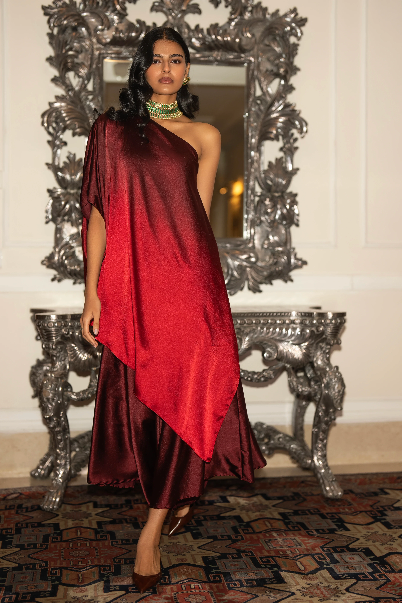

**[Dash & Dot ONE SHOULDER OMBRÉ TOP & DRAPED CULOTTE PANT
](https://www.dashanddot.com/products/one-shoulder-ombre-top-draped-culotte-pant-67607701913770)**

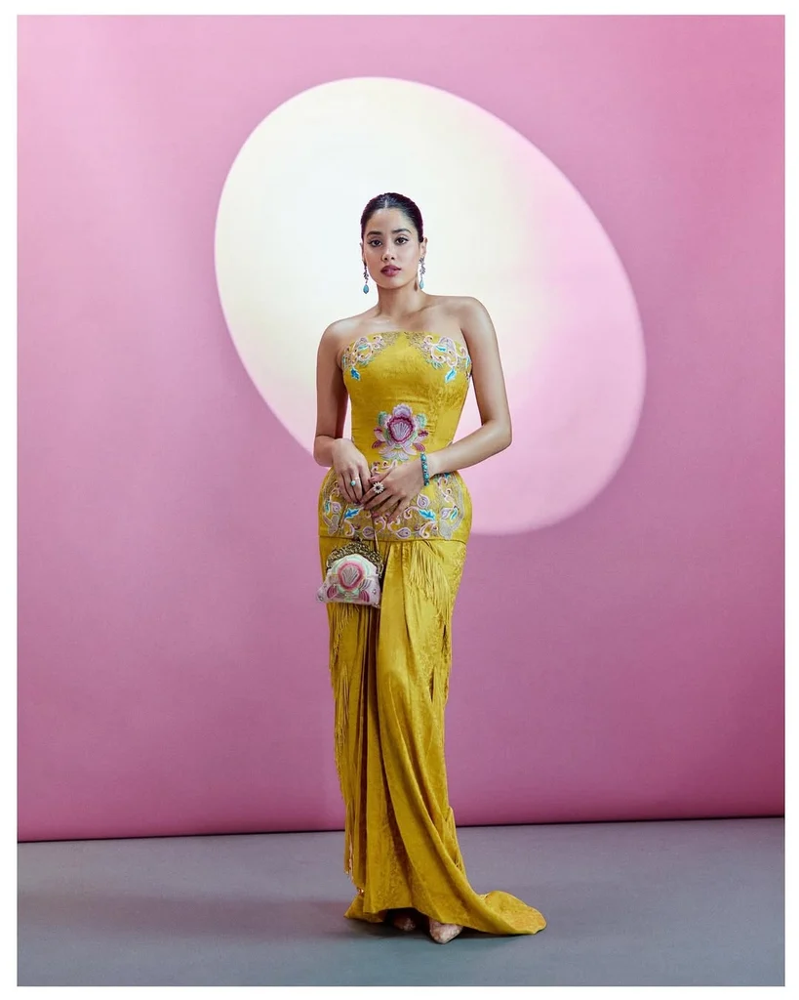

**[Anamika Khanna Mustard Jacquard Embroidered Corset & Skirt Set](https://anamikakhanna.com/products/tapestry-paired-with-knotted-skirt-set)**

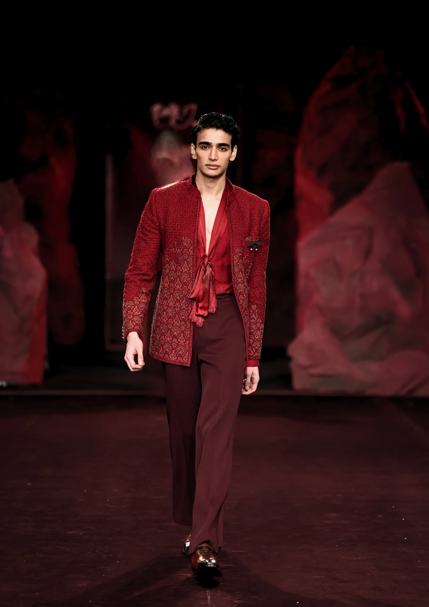

**[Dolly J Varen Jacket Set
](https://dollyjstudio.com/products/varen-jacket-set-braham26)**

**[Kalki Blue Strapless Hand Embellished Gown](https://in.kalkifashion.com/products/janhavi-kapoor-in-our-blue-strapless-hand-embellished-gown)** 

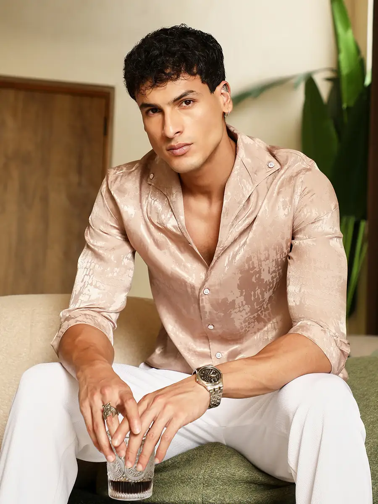

**[Cahoot Droplet-Jacquard Satin Shirt](https://cahoot.in/products/mens-light-khaki-droplet-jacquard-satin-shirt_csmssrt9893)**

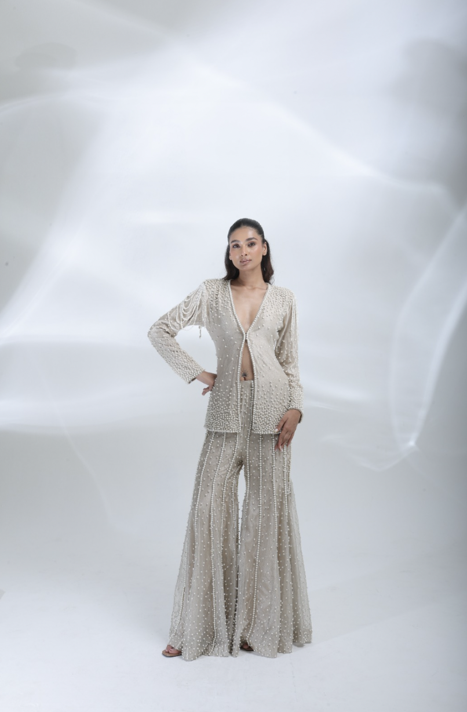

**[Pearl Co-ord Set By Deepanshi Massey](https://www.deepanshimassey.com/products/pearl-co-ord-set)**

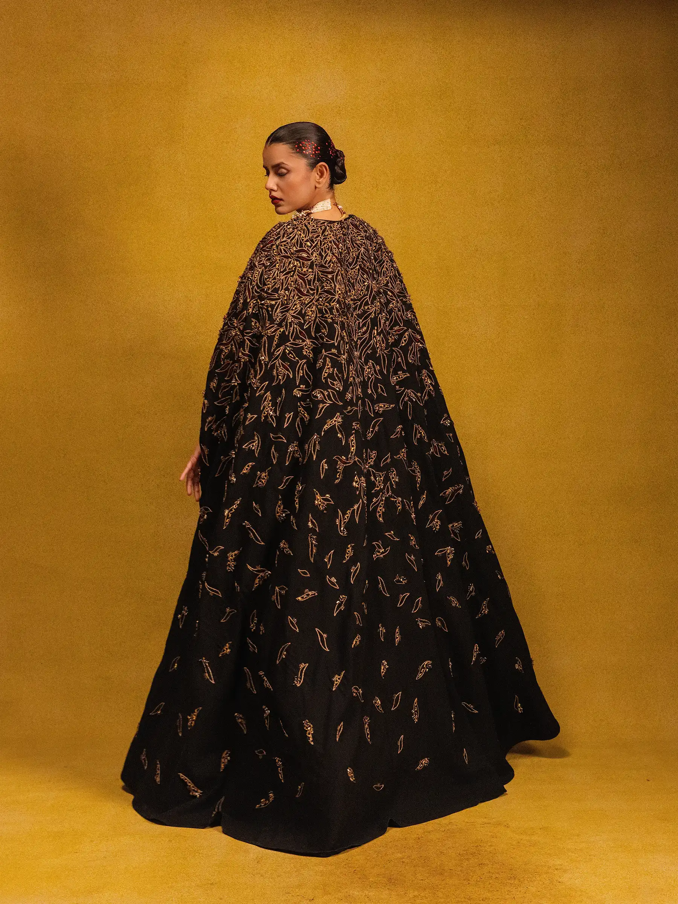

**[Mrunal Khimji Long Dress with Fully Embroidered Cape ](https://mrunalkhimji.com/collections/ignis/mk-42/)**

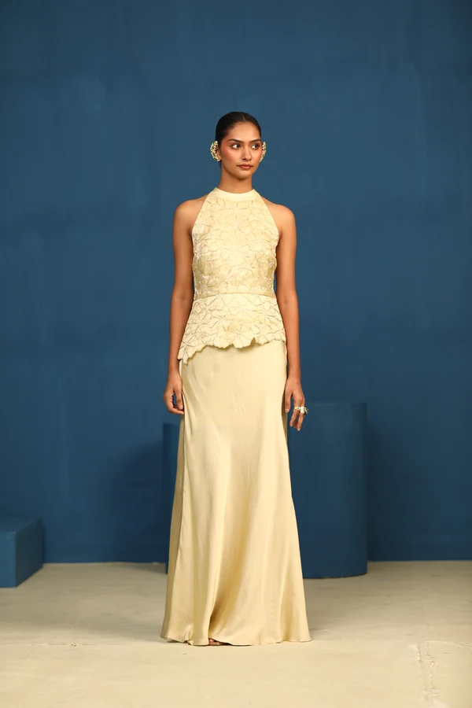

**[City Love By Vedangi Agarwal](https://www.azafashions.com/products/vedangi-agarwal-city-love-halter-neck-cutwork-top/760354?q=city%20love)**

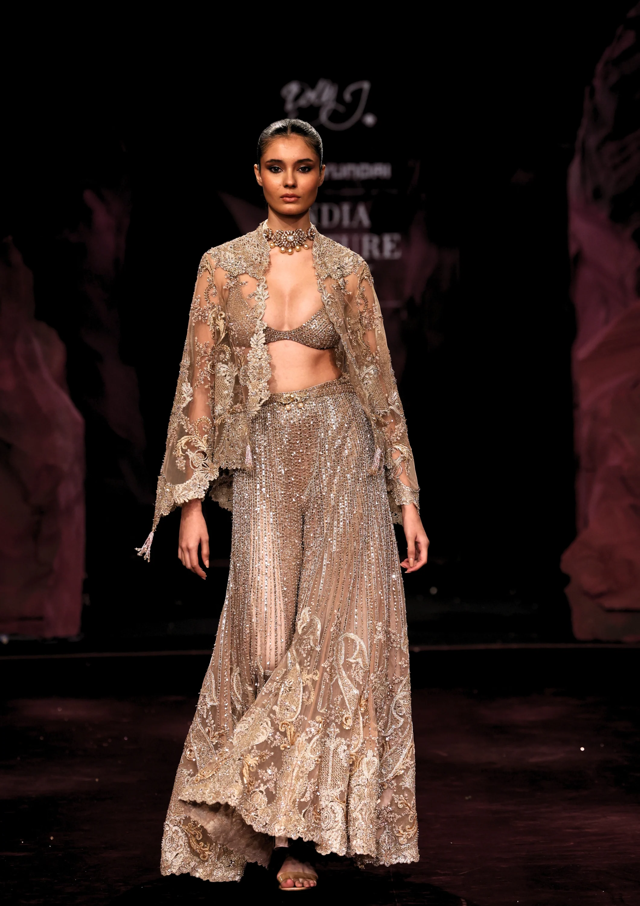

**[Dolly J Aakriti Sharara Set
](https://dollyjstudio.com/products/aakriti-sharara-set-braham26)**

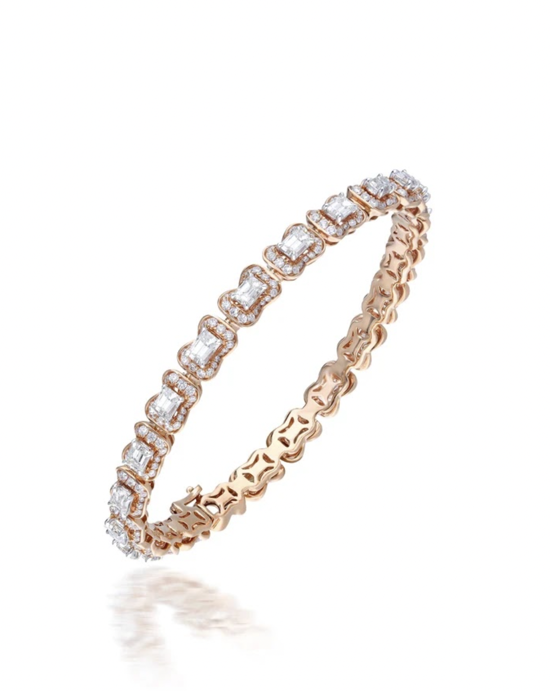

**[Serpentine Grace Bangle By AS Motiwala](https://asmotiwala.com/products/serpentine-grace-bangle)**

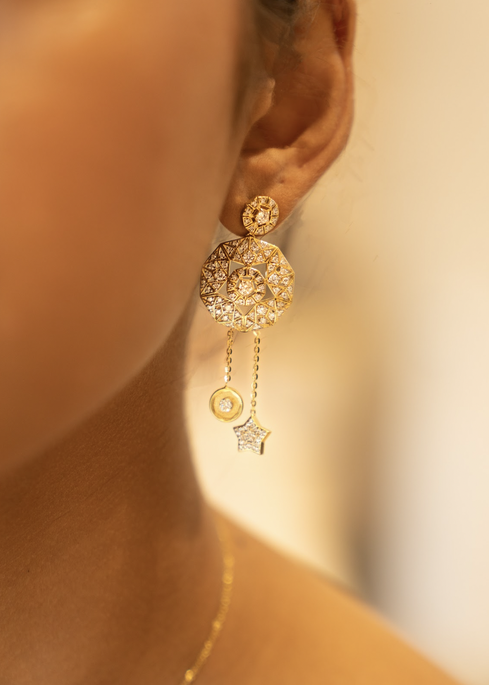

**[Abundance Talisman By Tenth Dimension Jewels](https://tenthdimensionjewels.com/)**

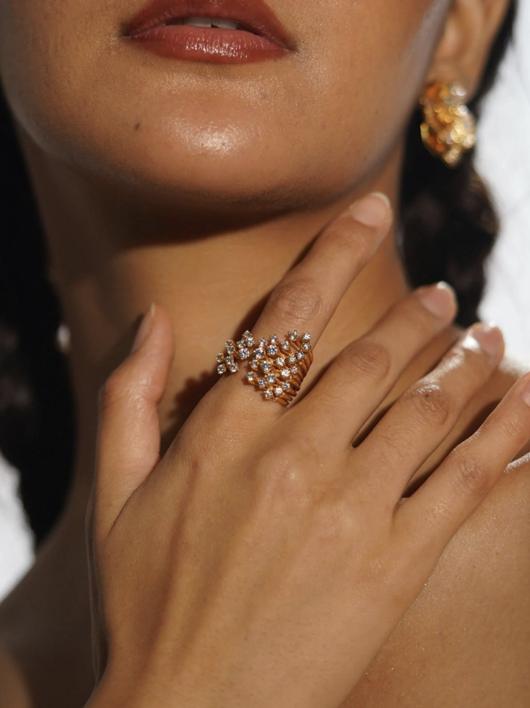

**[Nova Ring By Mhari
](https://www.mhari.in/products/nova-ring)**

**[Miss Jo Mystical Bloom Engagement Ring](https://missjo.com/products/mystical-bloom-engagement-ring)**

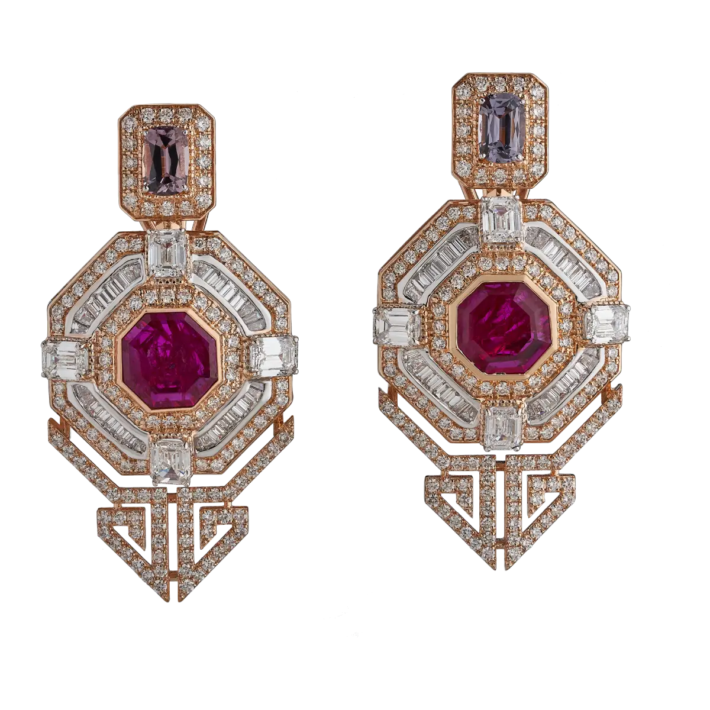

**[Deshya by Ma Passion EARRINGS SET WITH RUBY, SPINEL AND DIAMONDS](https://deshyaofficial.com/product/earrings-set-with-ruby-spinel-and-diamonds/)**

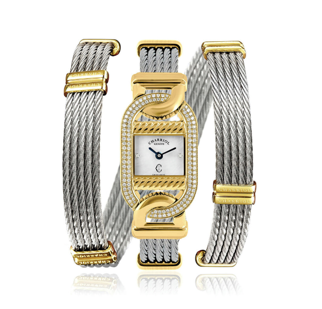

**[Charriol Women Mariner](https://www.helioswatchstore.com/charriol-women-mariner-square-mother-of-pearl-watches-ma20yd.510.001.html)**

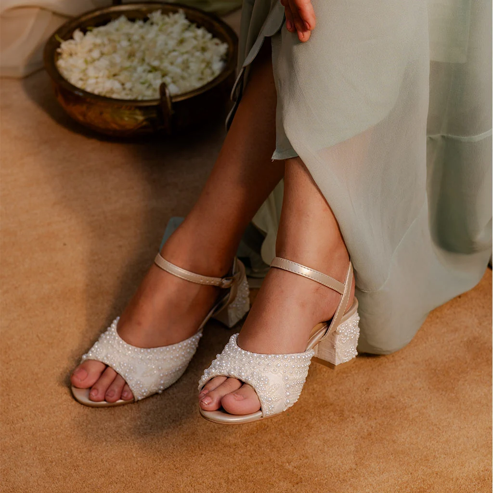

**[
Fizzy Goblet Pearls On The Floor](https://global.fizzygoblet.com/products/pearls-on-the-floor-sandal-heels?_pos=3&_sid=130198587&_ss=r)**

**The Last-Minute Rules**

* Dress for candlelight. Warm tones and metallics will look best.
* Test every outfit sitting down. If you cannot breathe or sit, rethink it.
* Avoid dangling sleeves and long dupattas near open flames and diyas.
* Carry a safety pin kit and a small touch-up pouch.
* Wear one statement, not three. Confidence reads louder than embellishment.

**The Finish**

The best Diwali party outfits are not the most expensive or the most elaborate. They are the ones worn with ease, by someone who looks like they chose them for themselves. Dress for the light, dress for the company, and let the evening do the rest.

***Follow Best List India for the culture, conversations, and ideas worth paying attention to.***
