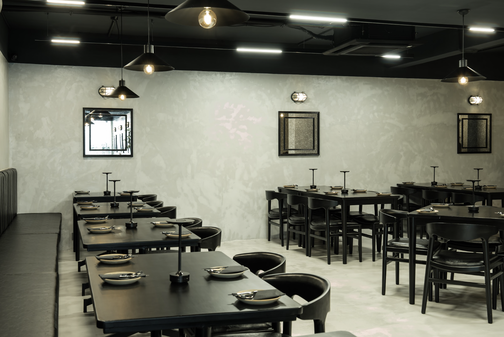
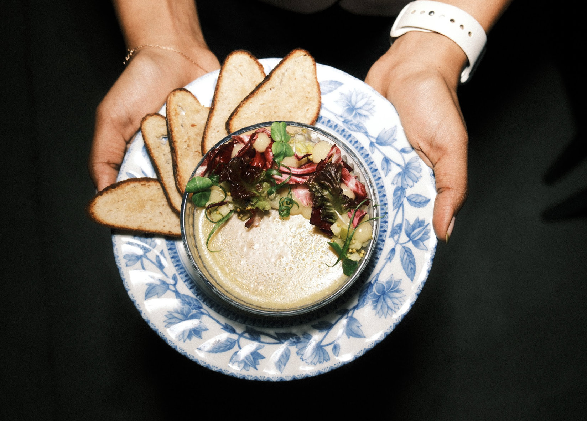
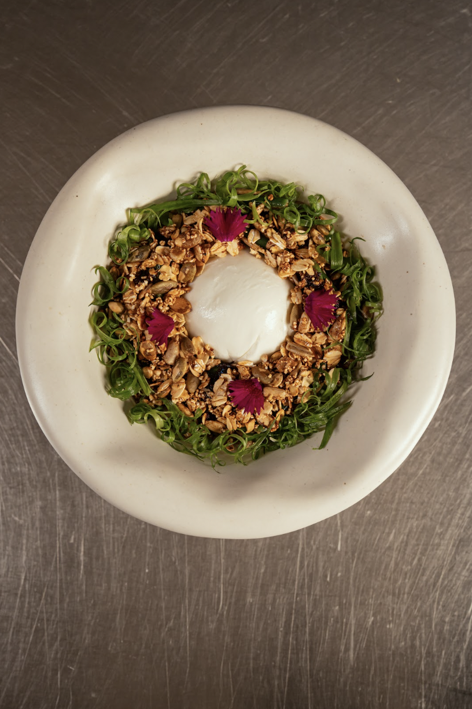
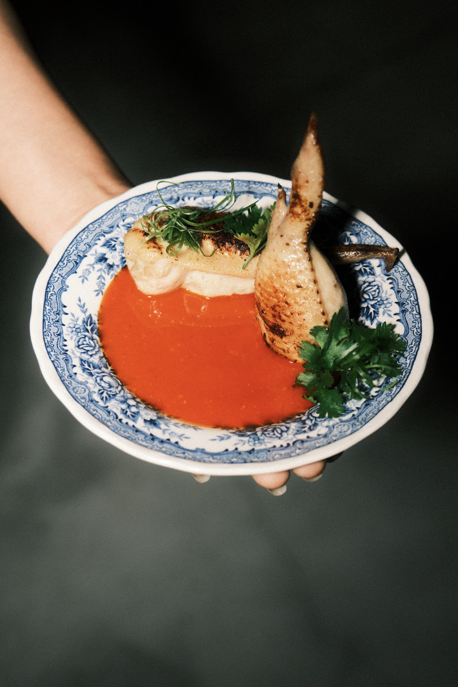
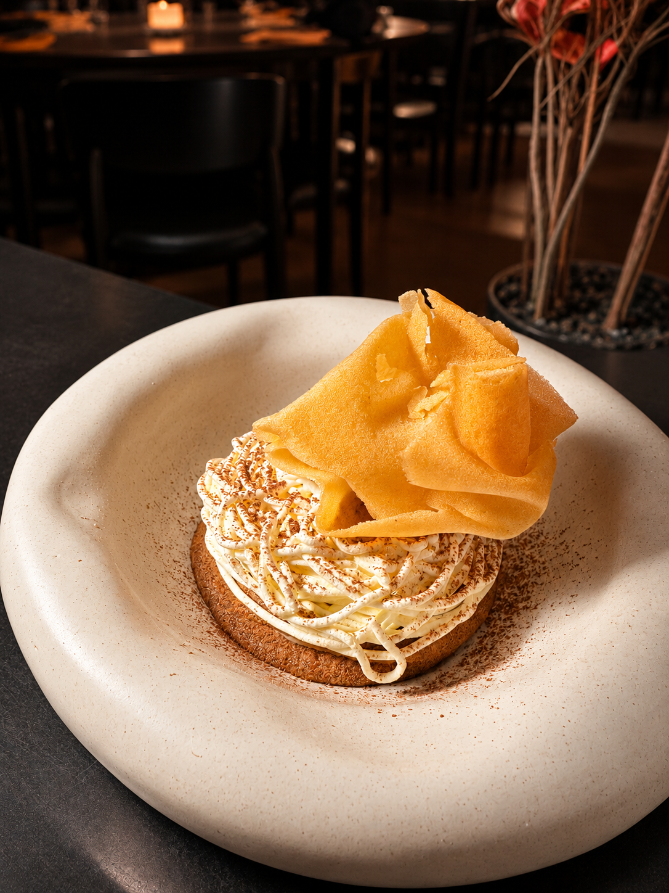

Some menus are a destination. At Circa 11, the menu is a journey, one that changes with the season, the produce and the mood of the room.

In Indiranagar, Chef Pradyumna Harithsa’s new seasonal dinner menu is a celebration of curiosity. It draws on many traditions instead of settling into one, taking familiar ingredients to delightful new places and moving from lighter, vegetable-led plates towards richer, more indulgent ones. It is a dinner made for savouring one plate at a time.

**The Bar Bites: A Gentle Opening**

The evening begins with warmth. The Grilled Confit Cabbage arrives with miso dressing, green goddess and garlic crumb, turning a humble vegetable into something quietly luxurious. Alongside it, Fried Goat Cheese with Bomba dip adds a playful, crowd-pleasing note.

**The Small Plates: Ingredients in Good Company**

This is where the kitchen’s imagination shines. Smoked Fresh Beans come with citrus truffle dressing, tofu espuma and puffed millets, and Roasted Carrots are paired with tomato XO and labneh. For something bright, there is the Red Snapper Ceviche with orange and passion-fruit ponzu, and for something indulgent, the Seared Pork Belly with a char siu glaze, pickled Thai chilli and miso aioli.

The ceviche tells the story of the whole menu. It has been part of Circa 11 since the beginning, and it blossoms anew each season. It started with passion fruit ponzu, then moved through cucumber and mint, and later mango, chilli and raw mango. This season it returns to passion fruit, joined by orange. The soul of the dish stays the same, always fresh, precise and easy to eat, while its flavours reflect the moment. As Chef Pradyumna puts it, consistency doesn’t mean a dish has to stay unchanged.

**The Larger Plates: A Passport of Flavours**

The mains travel the furthest. Biang Biang Noodles arrive with tofu and bok choy, and Ricotta and Lemon Raviolo is served with miso pumpkin sauce. Seafood Orzo brings together chorizo butter, prawns and clam meat, while Jackfruit Katsu Curry is paired with jasmine rice. Steamed Fish with Assamese black rice, herbs and garlic oil completes the savoury arc with a clean, regional note.

**A Dining Room That Shapeshifts**

Circa 11 was founded by Chef Pradyumna Harithsa, Sudhiksha Kaushik Anantharamu and Ankit Agarwal, and it describes itself as a shapeshifting dining room. Its rhythm moves from coffee and relaxed lunches to considered dinners and cocktails, and the menu embraces the same spirit of change.

For the chef, that means letting every dish grow. He says,

> *If the menu is meant to evolve, then the dishes have to be allowed to evolve too.*

Each new version is a chance to rebalance the cure, the acidity, the sweetness, the temperature and the amount of liquid on the plate. In the mango ceviche, for instance, raw mango was added to bring a bright, crisp edge to the fruit’s natural sweetness.

The kitchen also listens closely to its guests. Rather than waiting for one big comment, the team notices the quieter signals: what gets reordered, what guests ask about, and what they remember when they return. Those patterns help refine a dish, and sometimes the smallest adjustment makes it feel complete. 

Chef Pradyumna is clear that the restaurant keeps its own point of view. But he loves that the story doesn’t end in the kitchen. Once a dish reaches the table, the guest finishes the thought in their own way, with their own memories, appetite and mood.

**What Guests Take Home**

For all the technique on the plate, the chef’s own wish is lovely in its simplicity: he wants guests to remember that they had a really good time. Hospitality is at the heart of it, from a glass that never stays empty to a table where an older guest feels comfortable, and a team that senses when you’d like company and when you’d like a quiet moment. The room, the menu and the energy can all shift from coffee to lunch to dinner to cocktails, but the feeling of being looked after remains constant.

That is the spirit of the new dinner menu: adventurous, generous and full of warmth, an invitation to linger over a few unexpected turns and leave wanting to return.

**Factsheet**

**Where:** Circa 11, 957, 12th Main Rd, Indiranagar, Bengaluru

**Timings:** Tuesday to Sunday, 6:30 PM onwards

**Approximate price for two:** INR 3,500

**For reservations:** [bookings.airmenus.in/circa11/order](https://bookings.airmenus.in/circa11/order)

***Follow Best List India for the food, stories, and ideas worth paying attention to.***
