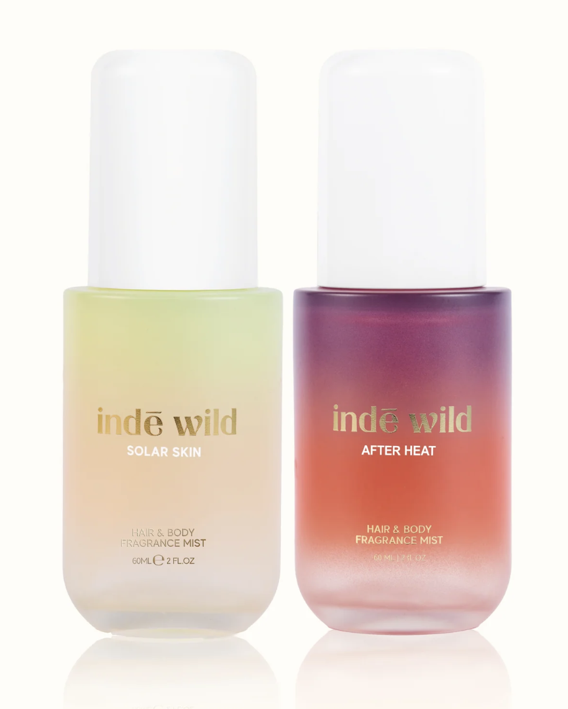
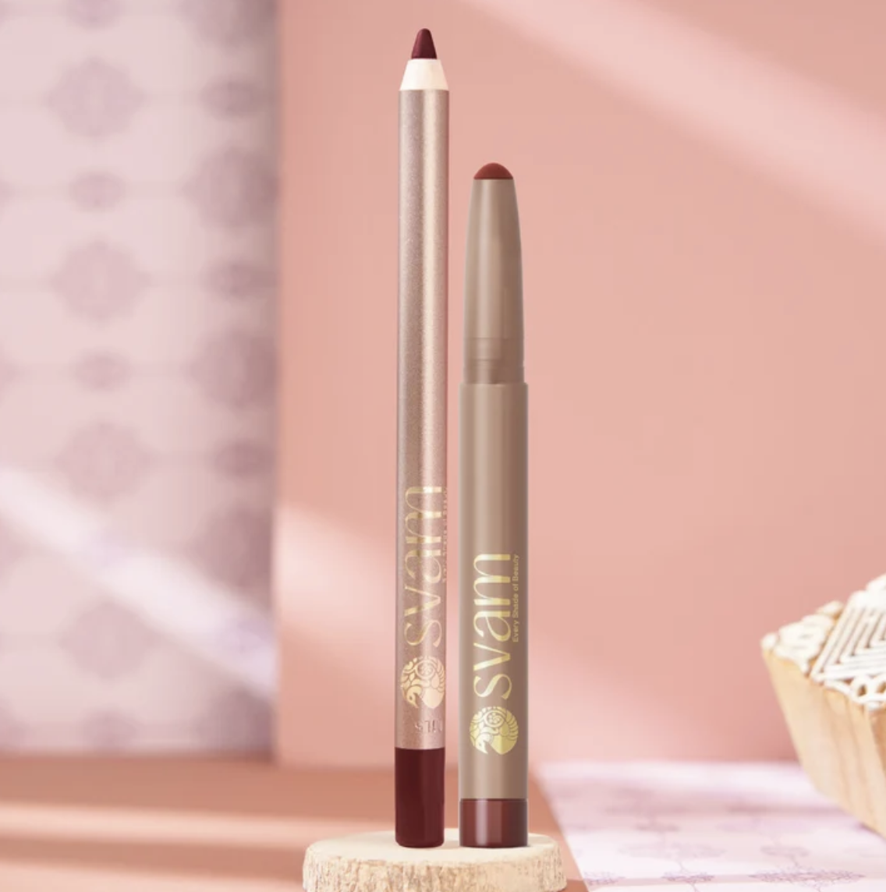
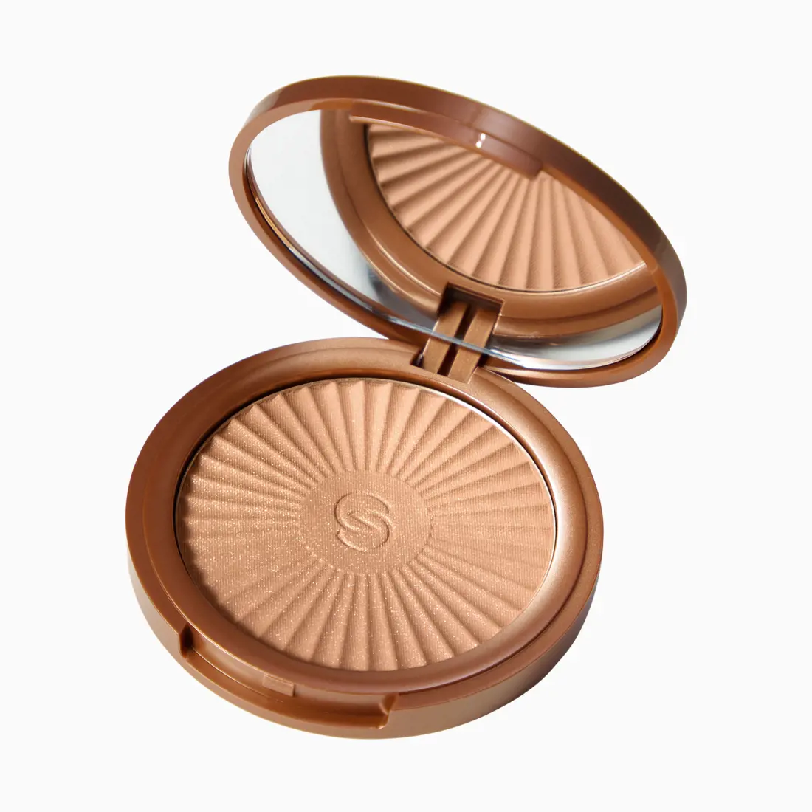
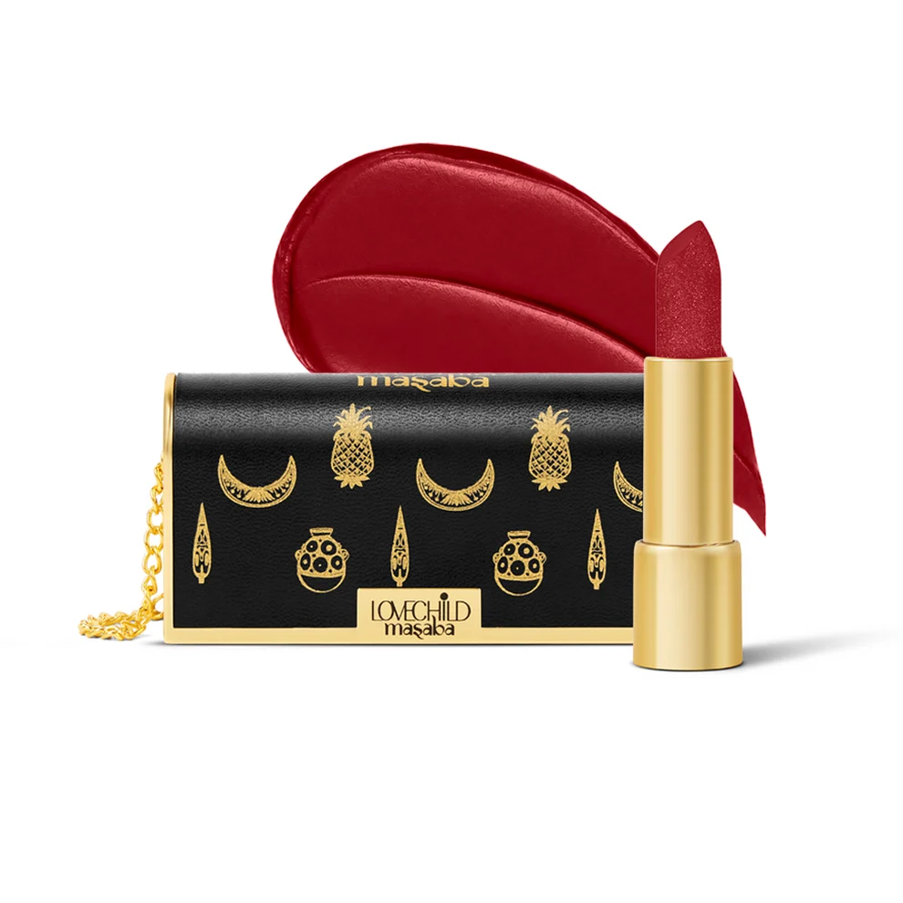
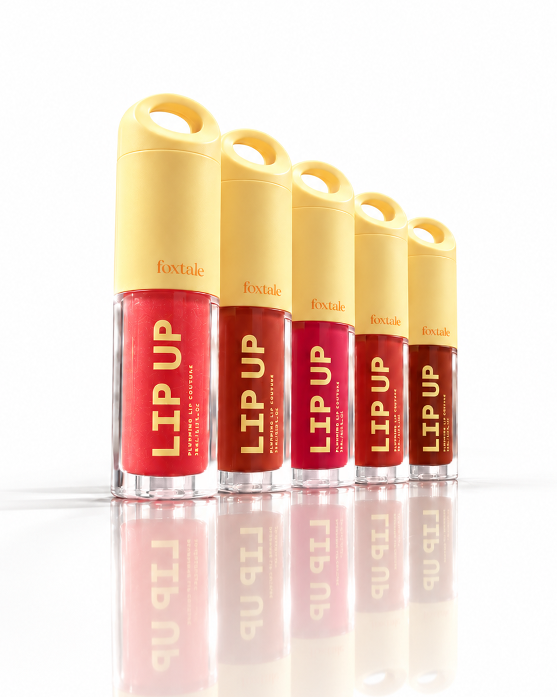
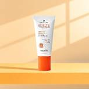
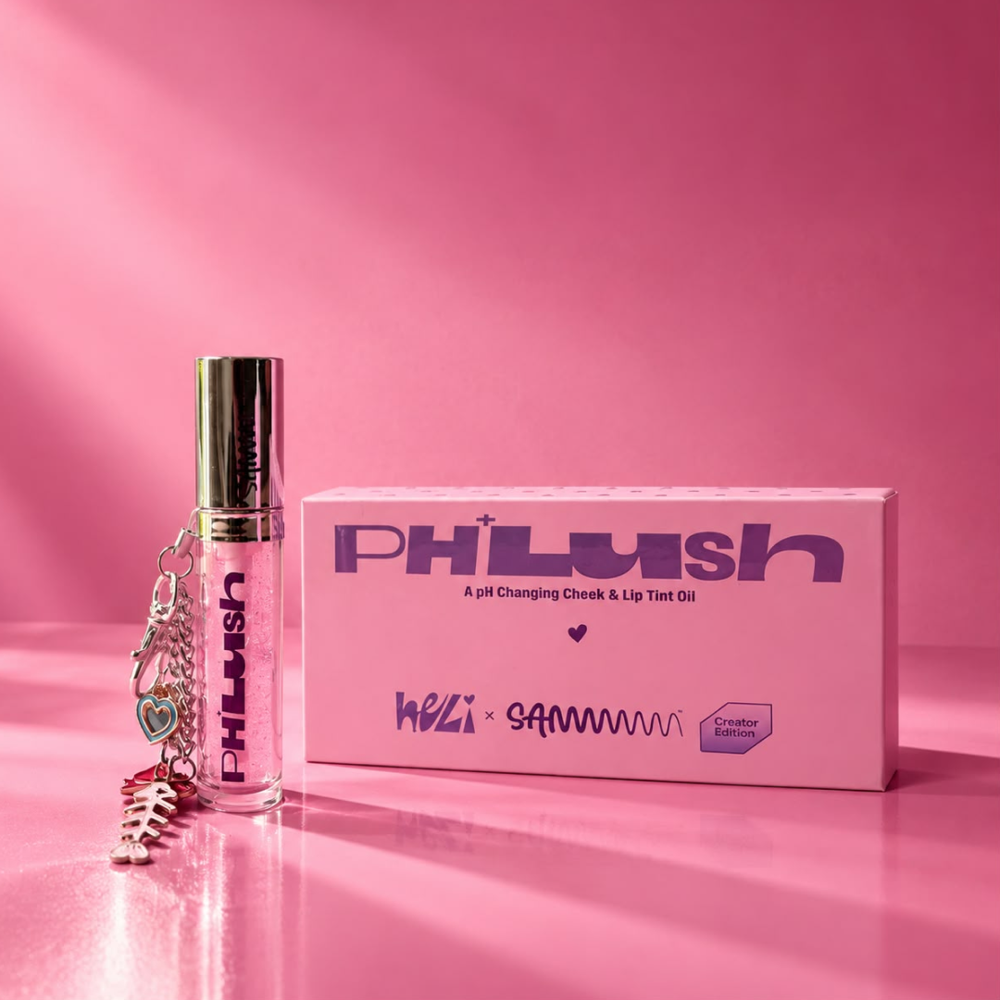
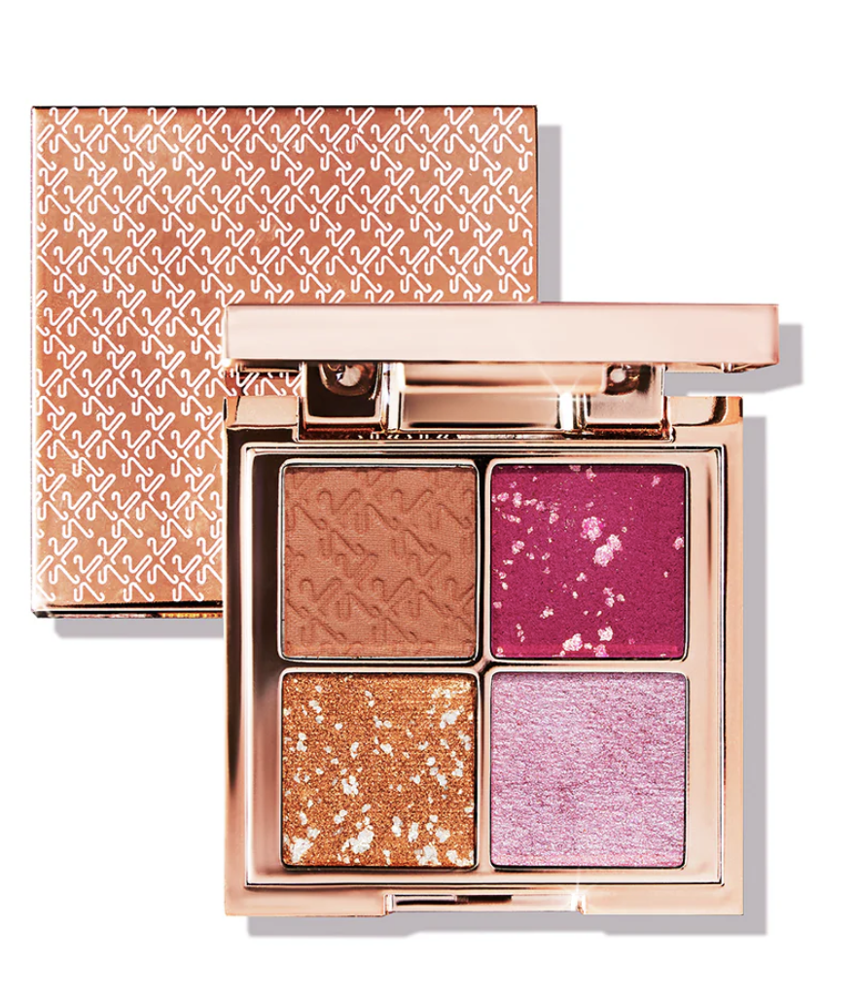

Diwali asks a lot of your face. It must look fresh at a morning puja, luminous in candlelight, and still composed at midnight over a hand of cards. The good news is that the festival is generous to anyone who prepares. With Diwali on Sunday 8 November, here is a brief in two parts: a countdown for your skin, and three looks for three very different moments.

From sunlit mornings to after-dark plans, this **[duo](https://india.indewild.com/products/sunrise-to-starlight-duo-bundle?variant=48354155331805)** from Inde wild has every moment covered.  Solar Skin wraps you in a soft, skin-close floral warmth, while After Heat turns up the intensity with spicy amber florals that linger long into the night. Both are powered by ScentFix Technology to help neutralize odour and leave hair and skin beautifully scented all day.

**[Know Your Worth from Svam Beauty](https://svambeauty.com/products/know-your-worth-combo-comfortmatte-lip-combo)** as a duo brings definition and colour together in one seamless system. The ComfortMatte™ Lip Liner shapes and defines with soft precision, while the ComfortMatte™ Lip Crayon fills in warm, clay-toned colour inspired by burnt sienna and earthy browns. Designed to work as one, this duo eliminates guesswork. No mismatched tones, no harsh edges, no touch-up anxiety. Just lips that look polished, feel natural, and stay comfortable from morning to night.

Achieve a radiant, sun-kissed look instantly with **[Giordani Gold's new Bronzing Powder](https://in.oriflame.com/products/product?code=46934)**, luxuriously scented with Giordani Gold Essenza Parfum. Designed for long lasting wear and suitable for all skin types, this bronzing powder for face and body offers flawless coverage with a refined finish, perfect for those who want to feel effortlessly chic and confident from morning to night.

Make a bold statement with **[LoveChild by Masaba’s Batua Pocket Lipstick in Gulaabo](https://lovechild.in/products/batua-pocket-lipstick-gulaabo-red?_pos=1&_psq=Batua+Pocket+Lipstick+-+Gulaabo+%28Red%29+Rich+Satin+Finish+With+In-built+Mirror&_psid=498a1f761&_ss=e)**, a vibrant red with a rich, satin finish and a hint of shimmer. Its hydrating formula glides effortlessly onto the lips, leaving behind a smooth, luminous finish. Housed in a charming, accessory-inspired case with an in-built mirror, it’s your perfect on-the-go glam essential.

For the beauty enthusiast who loves a little indulgence tucked into their everyday routine, **[Foxtale’s Lip UP Plumping Balm ](https://foxtale.in/products/lip-up-plumping-lip-serum)**makes a lovely addition to a festive beauty hamper. Powered by Rose PDRN, the formula brings together a high-shine finish, sheer colour and lip care in one easy swipe, while Mango Butter, Ceramide Complex and Collagen Peptides help hydrate and support the lip barrier. Available in five shades, from a clear peach-inspired glaze to richer berry and red-brown tones, it is a playful yet considered gift for someone who loves discovering a new beauty favourite. Small enough to slip into a handbag and special enough to feel like a treat, it is a little reminder to make room for self-care amid the festive rush.

Festive beauty is often about getting that fresh, even-toned look without layering on too much. A tinted sunscreen can bring sun protection and a naturally radiant finish into one step. **[Heliocare Color Gelcream SPF 50](https://www.skinspired.in/collections/heliocare-advanced-range/products/heliocare-color-gel-cream-spf-50?utm_source=chatgpt.com)** is a tinted sunscreen offering SPF 50 protection with a skin-natural, dewy glow. Powered by patented Fernblock® Technology, its lightweight, non-comedogenic formula blends seamlessly to give skin a fresh, even-toned finish without white cast, patchiness or piling.

For the beauty lover who enjoys a little colour and care in their everyday routine, **[SAMMMM’s PHLush](sammmm.com/products/phlush)** makes for a fun, thoughtful addition to a Diwali beauty hamper. Co-created with its Gen Z community, this lip product combines everyday makeup with a nourishing blend of Watermelon Seed Oil, Sweet Almond Oil, Coconut Oil and Vitamin E. Designed for effortless application without the fuss of shade matching, PHLush brings a comfortable, glossy finish to everyday beauty routines. A playful little pick for anyone who loves their beauty essentials with a touch of personality, it makes festive gifting feel personal, fun and full of self-expression.

Create endless eye looks with **[Kay Beauty’s Eye Kanvas Discover Eyeshadow Palette](https://www.kaybeauty.com/products/eye-kanvas-discover-eyeshadow-palette?_pos=1&_psq=Eye+Kanvas+Discover+Eyeshadow+Palette&_psid=6c3046e1e&_ss=e)**, featuring a versatile mix of richly pigmented matte and shimmer shades. Its buttery, blendable formula delivers seamless colour payoff with a no-fallout finish. Enriched with Vitamin E, it keeps lids feeling comfortable while taking your look from effortlessly natural to glam.

*Beauty at Diwali is not about perfection. It is about being at ease in the light, with people you love. Prepare your skin, pick your hero, and let the diyas do the rest.*

***Follow Best List India for the style, stays and stories worth planning your season around.***
