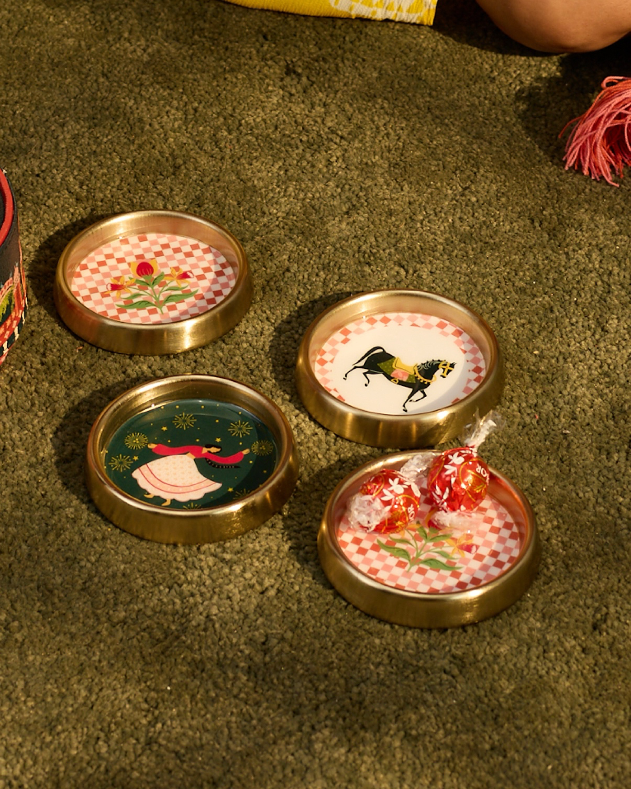
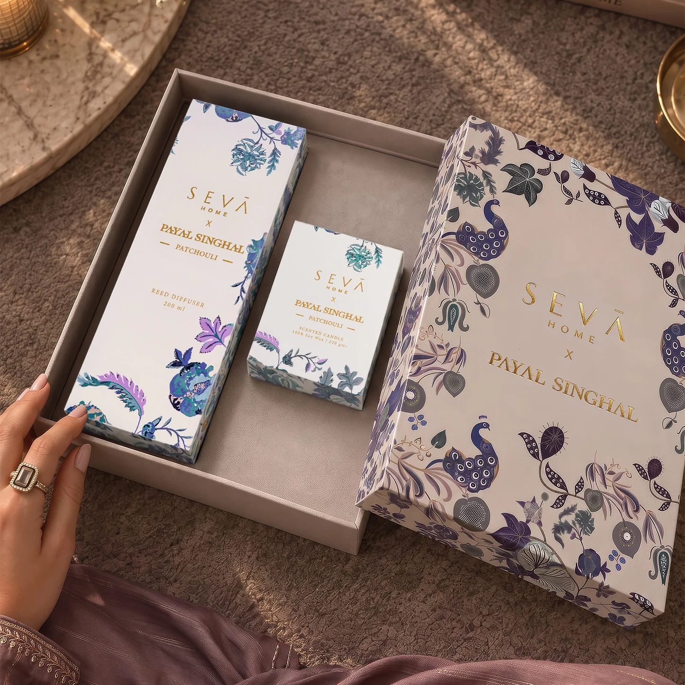
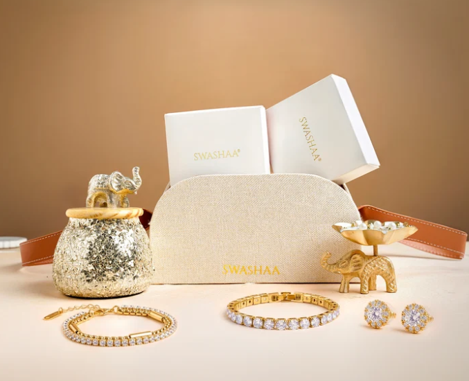
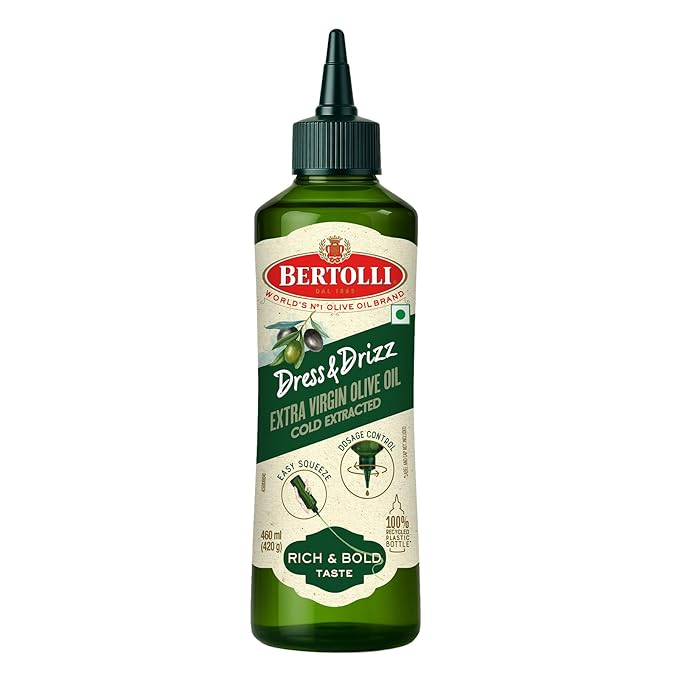
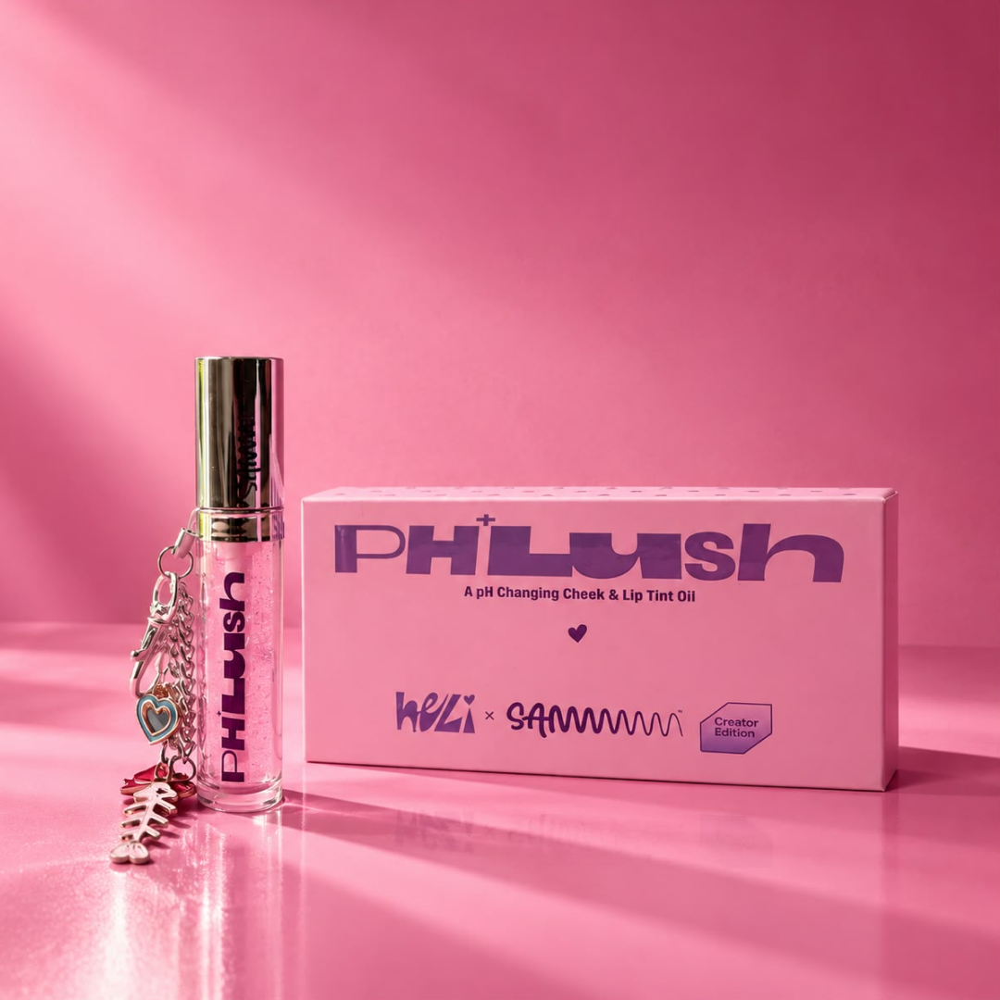
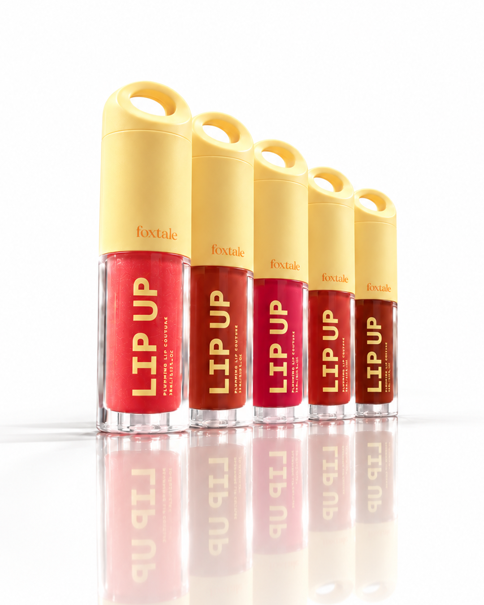

Diwali gifting is a peculiar kind of social choreography. It is warm, expected and slightly competitive, and every year the same quiet panic surfaces in the last week: what do you give the person who gave you everything last year? With Dhanteras on 6 November and Diwali on Sunday 8 November, the window to answer that question is closing.

The good news is that the best gifts rarely depend on budget. They depend on attention. A present that shows you noticed something about the person, their taste, their habits, their home, lands harder than any oversized hamper. Here is how to give well.

**Three Rules Before You Shop**

*Give to the person, not the occasion.* A generic box says Diwali. A considered gift says you.

*Edit, don’t accumulate.* One beautiful thing, wrapped well, beats five forgettable ones.

*Presentation is half the gift.* Ribbon, a handwritten note, a brass diya tucked beside the box: these small gestures carry the feeling.

**[Chumbak Charbhagh Coasters Set of 4 | Haveli Socials](https://www.chumbak.com/products/charbhagh-coasters-set-of-4-haveli-socials)**

Bring a playful festive touch to tea and coffee time with this set of 4 coasters featuring assorted folk-inspired motifs and vibrant patterns. Ideal for everyday use and festive gatherings

***Priced at 1,999 INR***

**[Seva Home x Payal Singhal Gift Set (Candle + Diffuser) - Patchouli](https://www.sevahome.in/collections/gifting-sets/products/seva-x-ps-gift-set-candle-diffuser-patchouli)**

Where artistry meets home fragrance, the **SEVA HOME x Payal Singhal Candle and Diffuser Gift Set** brings together the designer's signature Chintz print and the brand's distinctive fragrance sensibility. Featuring a scented candle and a reed diffuser in Patchouli, the set combines bright citrus notes with warm, earthy woods to create a comforting fragrance experience. With its distinctive design and versatile appeal, it makes an elegant festive gift for those who appreciate Indian design and beautifully scented living spaces.

***Priced 8,990 INR***

**[Sparkling Nights Diwali Jewellery Hamper from Swashaa](https://www.swashaa.com/collections/gift-hampers/products/sparkling-nights-diwali-jewellery-hamper)**

Whether you're celebrating with family or surprising someone special, this hamper makes every gift feel extra special.

***Priced at 2499 INR*** 

**[Baagh Brooch by Nia Studio](https://niastudio.in/products/baagh-brooch)**

Inspired by the majestic Bengal tiger, the Baagh Brooch is a versatile statement piece designed to be styled in endless ways.

***Priced at 2499 INR*** 

**[Bertolli Dress & Drizz Extra Virgin Olive Oil](https://www.amazon.in/Bertolli-Virgin-Squeeze-Control-Extracted/dp/B0G5Y6Q47K)**

A finishing drizzle can bring together a dish, whether it is a fresh salad, roasted vegetables, paneer or other festive favourites. Bertolli Dress & Drizz Extra Virgin Olive Oil comes in a distinctive squeeze bottle made from 100% recycled plastic, with a rotating nozzle that allows for precise drizzling and greater control over oil usage.

***Priced at 599 INR***

**[Fraganote: For the Love of Beautifully Scented Moments](https://fraganote.com/collections/gifting-collection)**

A fragrance can turn an ordinary day into a memory, making it a particularly personal gift for someone special. This Diwali, Fraganote brings a playful, contemporary touch to the art of gifting with sets that go beyond a single bottle. The **Game Night Essentials Set** pairs a 50 ml perfume with poker chips, playing cards and a card holder, making it an inspired pick for the friend who loves hosting. For those who enjoy a more layered ritual, the **Fragrance Ritual Kits** bring together an Eau de Parfum, body wash, body lotion and perfume roll-on, while the **Minis Duo** pairs After Shave and London Bar in two 25 ml bottles. The **Baked Vanilla Perfume & Candle Gift Set**, featuring a 50 ml perfume, Café Vanilla soy candle and 10 ml Spice Wood fragrance, is a cosy, sensorial choice for anyone who loves making home feel special.

***Priced at 1,399–2,999 INR***

**[SAMMMM: A Little PHLush of Everyday Indulgence](sammmm.com/products/phlush)**

For the beauty lover who enjoys a little colour and care in their everyday routine, **SAMMMM’s PHLush** makes for a fun, thoughtful addition to a Diwali beauty hamper. Co-created with its Gen Z community, this lip product combines everyday makeup with a nourishing blend of Watermelon Seed Oil, Sweet Almond Oil, Coconut Oil and Vitamin E. Designed for effortless application without the fuss of shade matching, PHLush brings a comfortable, glossy finish to everyday beauty routines. A playful little pick for anyone who loves their beauty essentials with a touch of personality, it makes festive gifting feel personal, fun and full of self-expression.

***Priced at 700 INR***

**[Foxtale: A Little Beauty Treat for Their Everyday Ritual](https://foxtale.in/products/lip-up-plumping-lip-serum)**

For the beauty enthusiast who loves a little indulgence tucked into their everyday routine, Foxtale’s **Lip UP Plumping Balm** makes a lovely addition to a festive beauty hamper. Powered by Rose PDRN, the formula brings together a high-shine finish, sheer colour and lip care in one easy swipe, while Mango Butter, Ceramide Complex and Collagen Peptides help hydrate and support the lip barrier. Available in five shades, from a clear peach-inspired glaze to richer berry and red-brown tones, it is a playful yet considered gift for someone who loves discovering a new beauty favourite. Small enough to slip into a handbag and special enough to feel like a treat, it is a little reminder to make room for self-care amid the festive rush.

***Priced at 325 INR for 3.5 ml***

**[Power Reset Gifting Edition with Custom Engraving by Glosskn](https://glosskn.com/products/power-reset-gifting-edition-custom-engraving)**

Make self-care feel truly personal with our customised Power Reset Gift Box. Featuring Power Cleanse, Power Melt and PowerBands, beautifully presented with personalised engraving. Created for moments worth remembering.

Ingredients: 

* From Power Cleanse: Squalane · Moringa · Rice Extract · Gentle Cleansing System
* From Power Melt: Plum Kernel Oil · Jojoba Oil · Squalane

***Priced at 2455 INR*** 

**Wrapping and Etiquette**

* Wrap in earthy, festive tones: terracotta, mustard, deep green, burgundy and gold.
* Add a natural element: a sprig of dried flowers, a cinnamon stick or a small brass bell.
* Include a handwritten note, even if short.
* Deliver on time. A gift that arrives after Diwali is a missed moment.
* When receiving, always say thank you in person or by message within a day.

**The Finish**

The mark of a great gift is not what it costs. It is the feeling that someone paused, thought of you, and made an effort. In a season built on light, that quiet attention is the real luxury, and the one worth giving.

***Follow Best List India for the style, stays and stories worth planning your season around.***
