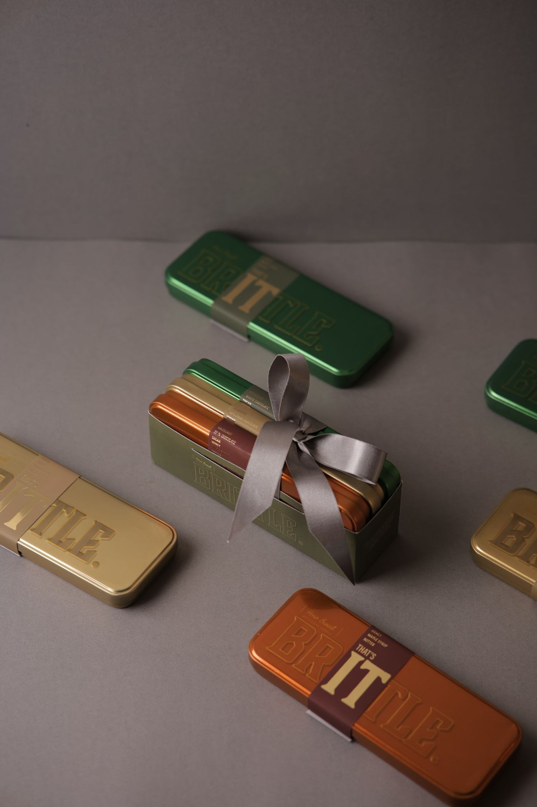
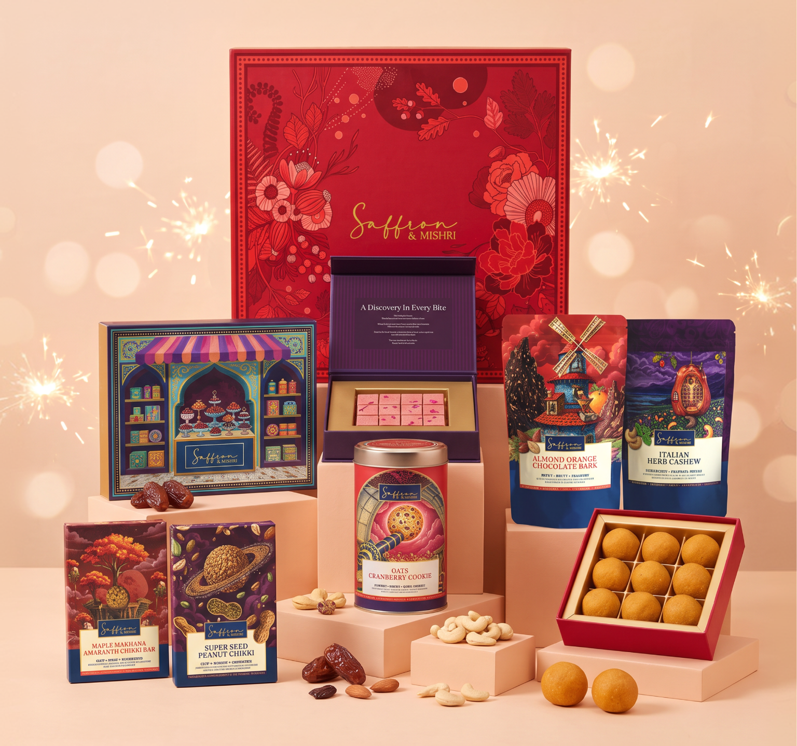
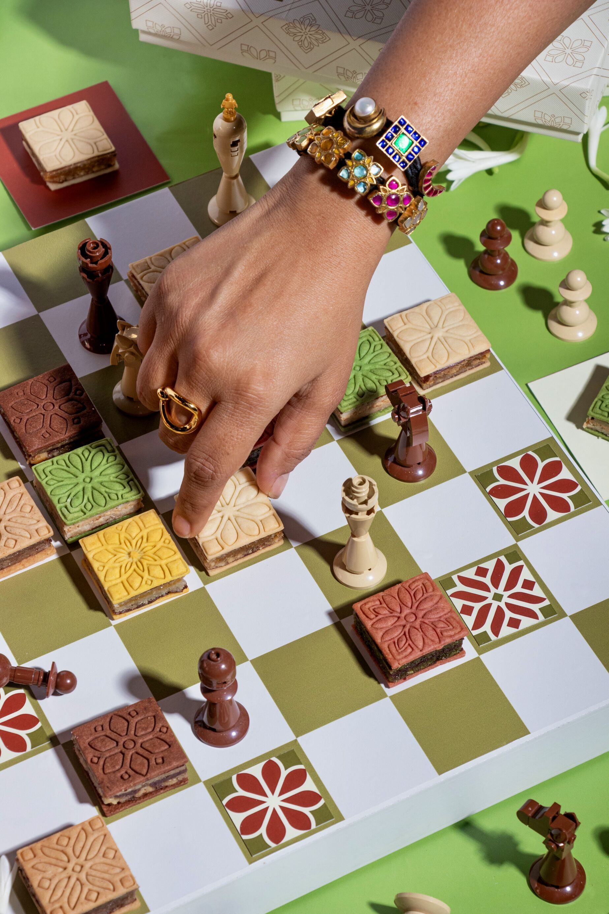
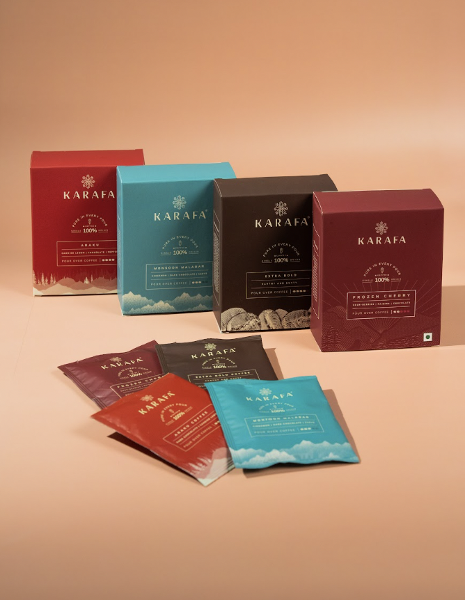
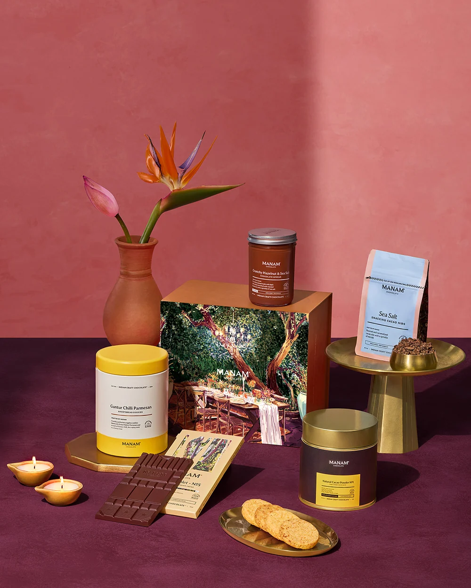
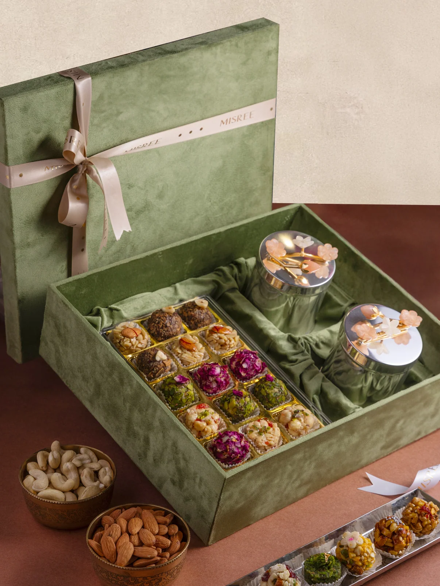
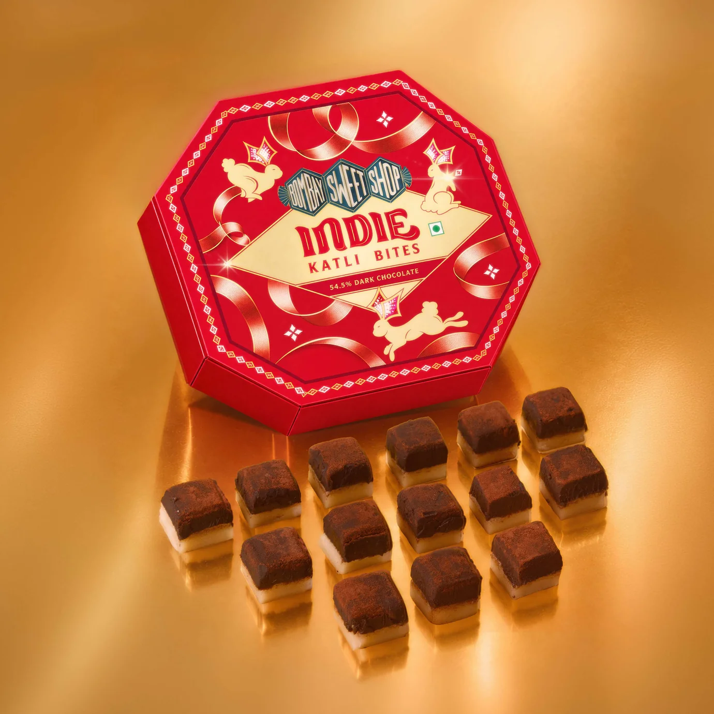

For generations, the Diwali sweet box followed an unwritten rule: familiar, generous, slightly overwhelming. Kaju katli, soan papdi, a few laddoos, perhaps a gulab jamun tin that arrived with the neighbour’s greeting. Delicious, certainly, but rarely surprising.

That script is being rewritten. This Diwali, with the festival falling on Sunday 8 November, India’s sweet counters look more like patisseries than halwai shops, and the people behind them are treating mithai with the same ambition that a generation of chefs brought to Indian restaurants. The category is big, with the sweets market estimated at roughly ₹84,310 crore, of which a small but growing luxury corner is thought to account for around 0.5 percent. It is in that corner that the most interesting work is happening.

**How Sweet - Brittle:** A delicacy crafted into a refined treat, featuring roasted nuts, caramelised cane sugar and the rich indulgence of couverture chocolate. Each brittle is carefully crafted, with the sugar rolled thin to achieve its signature delicate crunch, before being enrobed in a layer of smooth couverture chocolate that perfectly complements the nuttiness of the caramelised nuts.

**Saffron & Mishri:** At the heart of the collection is Saffron & Mishri’s approach to festive gifting, where the joy of traditional mithai meets the excitement of unexpected flavour combinations. Moving beyond conventional sweet boxes, the assortment brings together handcrafted mithai, contemporary confections, savoury favourites and festive accompaniments. From the Pistachio Kunafa Kaju Katli Bar, Strawberry Matcha Kaju Katli Bar, Espresso Coffee Kaju Katli Bar and Mango Passion Fruit Kaju Katli Bar to indulgent creations such as Kaju Misu Reserve and Dark Chocolate Peda Noir, the collection offers a fresh take on familiar festive favourites. Complementing the sweets are savoury options such as Thai Sweet Chilli Millet Bhujia and Bombay Masala Roasted Edamame, bringing together an assortment of distinctive flavours and textures for a memorable festive gifting experience.

**Sage & Saffron:** This festive season, Sage & Saffron introduces its signature Diwali collection - the Mithai Biscuit. A modern interpretation of classic Indian mithai, the collection bridges heritage and modernity. Each biscuit is crafted to adorn your grazing displays, discovering new flavours and passing a little extra sweetness along to brighten up your season. The collection features a palette of six signature flavours, each distinguished by its own naturally derived shade:

* Pistachio, Raspberry & Rose: A delicate floral and nutty combination balanced with a subtle, bright tartness
* Hazelnut, Coffee & Orange: Rich, roasted coffee notes paired with lively citrus zests and velvety nuts
* Almond, Apricot & Nutmeg: Warm, aromatic spices blended with sweet stone fruit and classic almond
* Cashew & Coconut: A rich, tropical indulgence rooted in classic Indian festive notes
* Pecan, Apple & Cinnamon: Comforting autumn-inspired flavours infused with a subtle, delicate crunch
* Walnut, Fig & Date: Deep, caramelised sweetness from natural dried fruits paired with earthy walnut

**Karafa Coffee:** This Diwali, skip the predictable sweets and gift something made for slow, indulgent moments. Karafa’s gifting selection brings together thoughtfully crafted coffee and chocolate, making it a perfect pick for the coffee lover in your life.

From the Cold Brew Boxes in Cocoa Noir and Nectar, offering everything from rich dark chocolate notes to bright, fruity flavours, to the Pourover Boxes featuring Araku, Monsoon Malabar, Extra Bold and Frozen Cherry, there’s a brew to suit every palate. For those with a sweet tooth, Karafa’s 54%, 72% and 90% cacao chocolate bars, along with its sugar-free option, offer another way to savour the festive season. Crafted in-house using cacao from the Godavari region, the chocolate is made without additives, chemicals or substitutes, allowing the natural character of the cacao to shine through.

Whether it’s a thoughtful gift for a coffee connoisseur, a festive hamper for a loved one, or simply a little something for yourself, Karafa’s selection makes gifting this Diwali a little more delicious.

**Manam Chocolate:** A gift box curated for moments you can enjoy all to yourself, for solo snacking, and to celebrate the indulgent downtime that completes that feeling of being back home.

* Natural Cacao Powder No. 1 | West Godavari - 200 g
* Crunchy Hazelnut & Sea Salt Chocolate Spread | 67% Dark - 265 g
* Guntur Chilli Parmesan Shortbread Cookies - 200 g
* Indian Origin Tablet No. 5 | 80% Dark - 80 g
* Sea Salt Snacking Cacao Nibs - 100 g

**Misree:** Wrapped in velvet, filled with love. This indulgent hamper brings together 16 artisanal sweets and two jars of dry fruits or savouries — a perfect blend of festive flavours and thoughtful gifting. Sweetness, redefined for every celebration.

**Bombay Sweet Shop:** Indie Bites - 54.5% Dark Chocolate Kaju Katli: Bite-sized Kaju Katli finished with dark chocolate, bringing a chocolatey twist to the classic Indian mithai.

**How to Choose a Box Worth Giving**

* **Know the recipient.**

   Traditionalists tend to prefer familiar flavours with better ingredients, while younger, adventurous recipients will enjoy the fusion options.
* **Check freshness and shelf life.**

   Milk-based sweets are best delivered close to Diwali, while nut-based and dry mithai travel better.
* **Look at the packaging.**

   If the box will sit on a console for days, it should be worth displaying.
* **Mind dietary needs.**

   Many modern brands now offer lower-sugar or plant-based options, which can be thoughtful for health-conscious guests.
* **Pair thoughtfully.**

   A mithai box beside flowers, a candle or a bottle of something good turns a gift into an occasion.

**The Finish**

Mithai has always been about more than sugar. It is how families say welcome, how neighbours say thank you, and how a festival makes itself tangible. What the new guard has done is remind us that tradition is strongest when it keeps evolving. The best boxes this Diwali honour the sweet they started with and then, quietly, ask whether it could be even better.

***Follow Best List India for the style, stays and stories worth planning your season around.***
