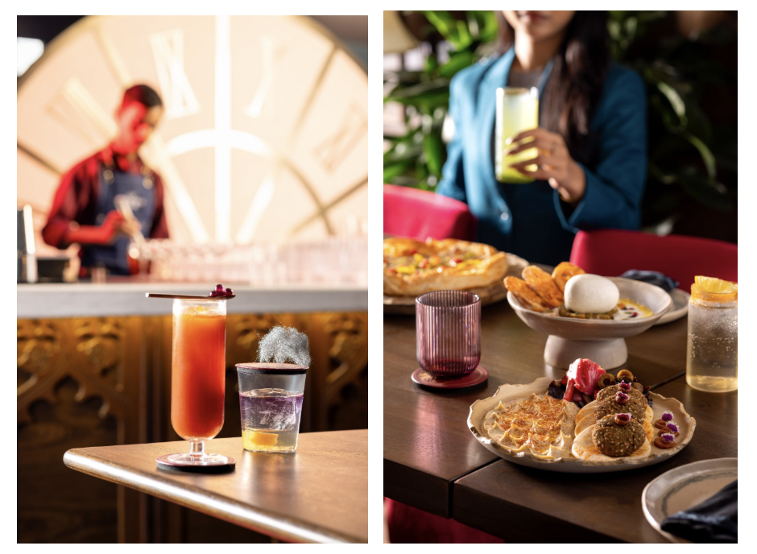
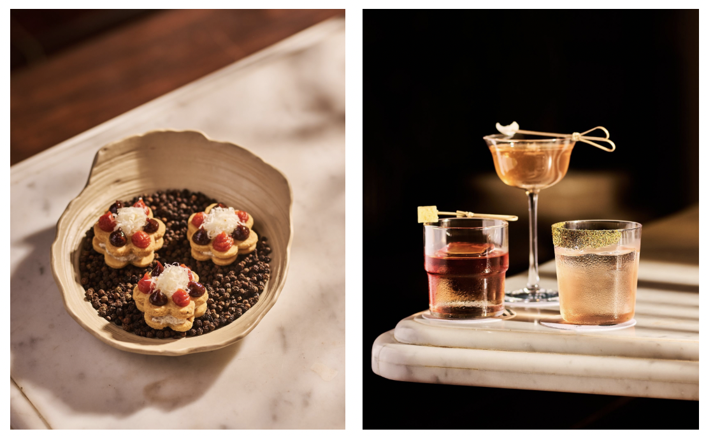
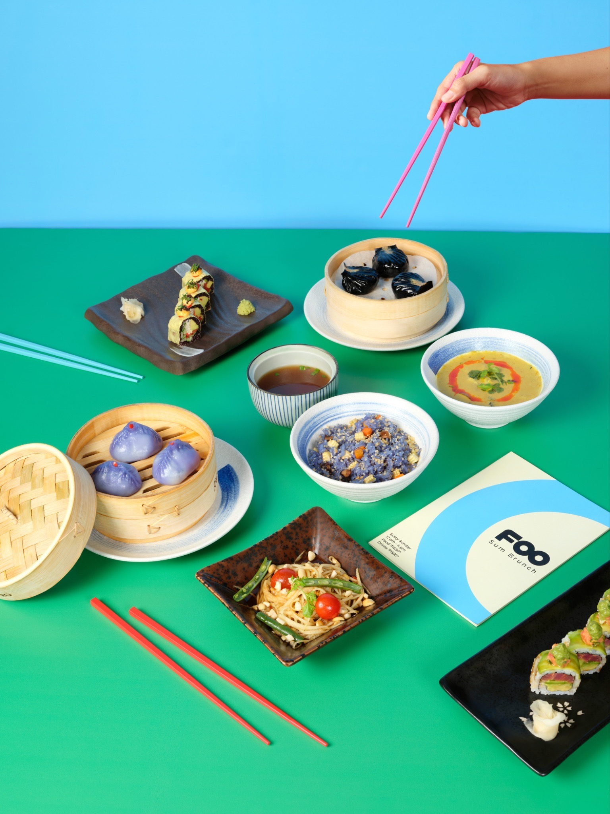
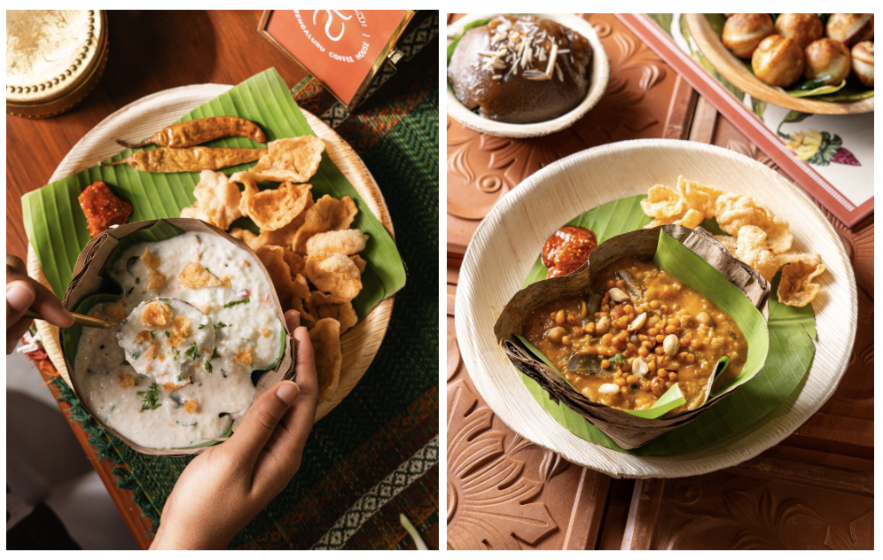
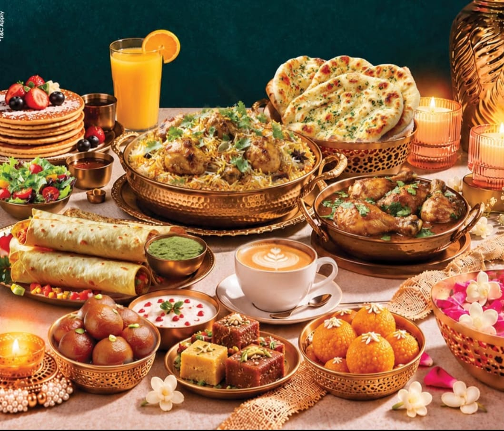
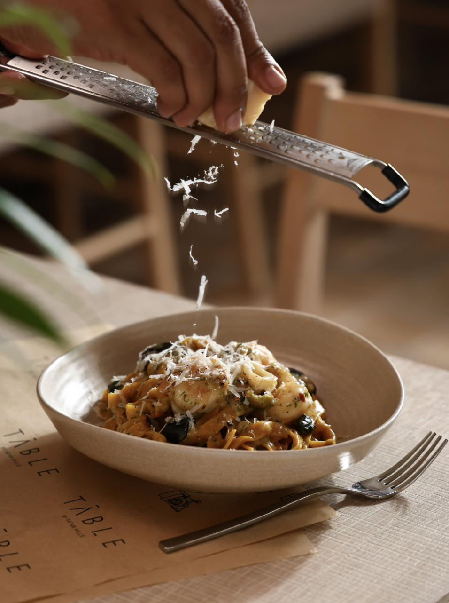
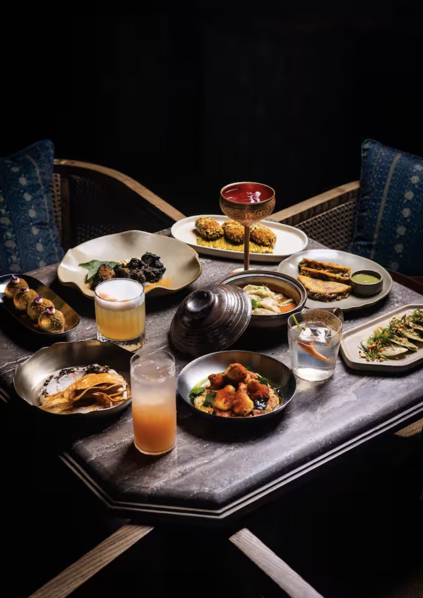
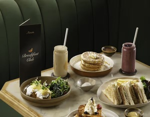
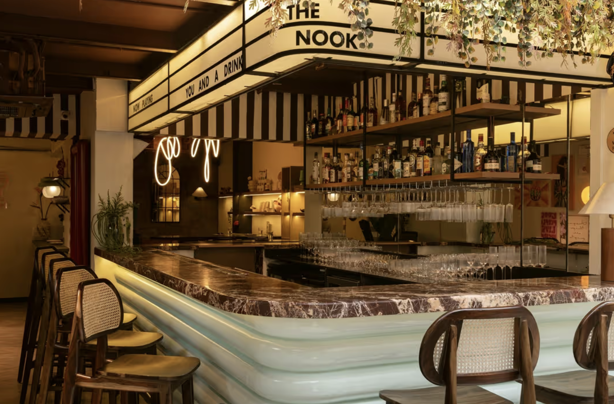
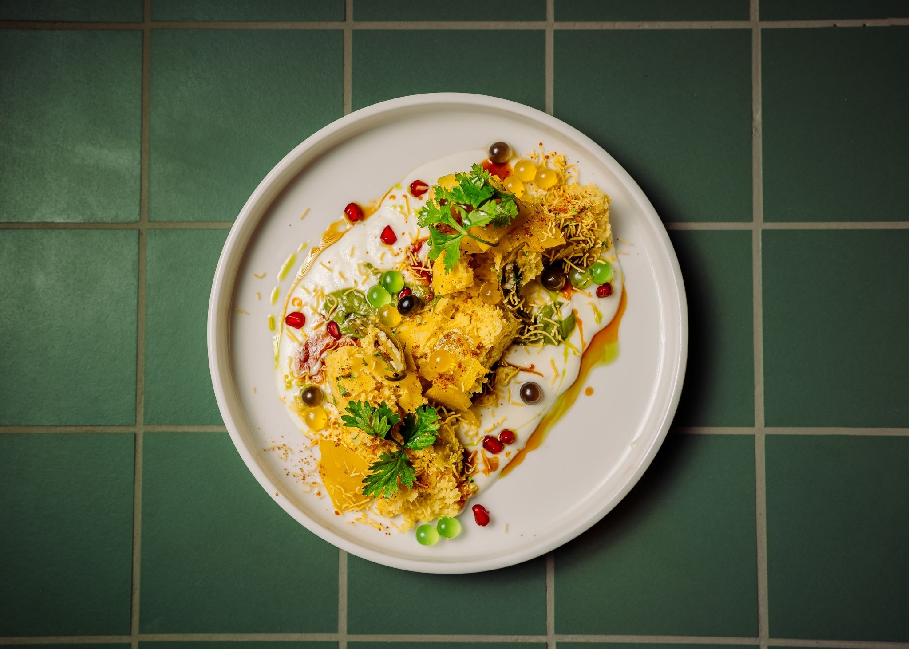

Diwali has always been about the table. The sweets arrive before the lamps are lit, the thalis are planned weeks ahead, and somewhere between the puja and the card party, someone inevitably asks what’s for lunch.

This year, the calendar helps. Diwali falls on Sunday, 8 November, with Lakshmi Puja in the evening, which leaves the whole day open for a long, unhurried brunch. The weekend before offers its own window, with the festive mood building and the city dressed in lights.

Here is where we’d spend it.

### **Swinton House, Kolkata**

The Swinton House on Park Street sets the tone for an experience that goes beyond the plate. Designed as Mr. Swinton’s apartment, the space unfolds across rooms inspired by his bedroom, office and library, with vintage details and a luxurious washroom featuring a jacuzzi. Curated by Chef Prince Beniwal, the menu brings together modern European café cuisine and Kolkata favourites such as Phuchka, Jhalmuri and Kosha Mangsho. Head Mixologist Ankur’s cocktail programme draws on coffee, florals, spices and regional influences. Whether for a leisurely festive lunch or an evening of cocktails and conversation, The Swinton House offers a distinctive setting to celebrate Diwali.

### **Call Me Sofia, Mumbai**

For a Diwali evening that calls for inventive drinks and unconventional plans, Call Me Sofia in Khar brings its concept to life through creative cocktails, alcohol-free serves and edible cocktail creations. Highlights from its cocktail menu include Wild Thing, which combines bourbon, sourdough, farmer’s jam, house-made mushroom beer and balsamic, and Call Me Picante, blending tequila, gin, strawberry, baby spinach and jalapeño brine. Those looking for zero-proof options can try Soft Launch, featuring black rice syrup, black lime and a Parmesan tuile, or Main Squeeze, made with baby arugula, pineapple and strawberry acid. Pair the drinks with Truffle Burrata Sammies or Carbonara Pizzette for a festive evening of unexpected flavours and Italian-inspired small plates, perfect for catching up with friends over the holiday!

### **Foo, Hyderabad**

Celebrate Diwali with FOO’s specially curated Diwali brunch, bringing together signature Pan-Asian flavours, handcrafted beverages and indulgent desserts. From Salmon Truffle Maki and Wasabi, Truffle & Edamame Dumplings to FOO Yellow Curry and Blue Butter Japanese Fried Rice, the spread promises a leisurely afternoon of generous plates and distinctive flavours. Complementing the menu are refreshing mocktails, wellness boosters and signature cocktails, with Mango Cheesecake and Snickerz Nut Crunch adding a sweet finish. Perfect for festive family gatherings and catch-ups with friends, FOO’s Diwali Brunch invites guests to come together over good food and great company.

### **Namah - Bengaluru Coffee House**

For a relaxed Diwali lunch or a coffee date between festive plans, Namah – Bengaluru Coffee House brings regional Karnataka flavours and café culture together. Its menu celebrates local favourites, offering a comforting option for those looking to explore regional cuisine over a leisurely meal. Guests can also enjoy hot or iced Filter Kaapi or the indulgent Filter Coffee Milkshake, making it a great spot to catch up with friends and family over coffee and conversation during the festive season.

### **Seasonal Tastes, The Westin Chennai Velachery**

This Diwali, Seasonal Tastes at The Westin Chennai Velachery invites guests to spend the festival around a table filled with good food, good company and a lot of light. Diwali Brunch: A Festival of Flavours and Light will be held on Sunday, 8th November, bringing together the dishes people look forward to every festive season.

The spread begins with traditional Indian delicacies, prepared the way they are cooked at home during the festival. Live chaat counters will serve favorites made fresh on the spot, while the kebab counters turn out succulent grills straight off the fire. The main course offers both vegetarian and non-vegetarian dishes, with a menu planned so that everyone at the table, finds something they enjoy. Guests who prefer a break from Indian flavours can choose from a selection of International favourites.

### **TĀBLE by Tatva Hills, New Delhi**

Located at The Gallery on MG in Sultanpur, TĀBLE by Tatva Hills offers an all-day dining experience rooted in fresh ingredients and a farm-to-table philosophy. Its relaxed setting and considered culinary approach make it an appealing destination for a festive meal, whether you're planning a family gathering or looking to celebrate Diwali over a thoughtfully prepared spread in a setting away from the city's bustle.

### **INDY by Q’la, New Delhi**

INDY by Q’la reimagines Indian cuisine through a contemporary lens, bringing familiar flavours together with modern culinary interpretations. Set in an elegant space in Malviya Nagar, the restaurant pairs a thoughtfully curated menu with creative cocktails and a sophisticated ambience, making it a distinctive choice for celebrating Diwali over contemporary Indian cuisine with friends and family.

### **Marièta | Gurugram**

Marièta brings together European and Asian culinary influences in a stylish, contemporary setting, making it an appealing choice for a Diwali celebration. With its flavour-forward menu, thoughtfully crafted cocktails and chic interiors, the restaurant offers an inviting backdrop for festive gatherings, special occasions and leisurely evenings with friends and family.

### **The Nook Brunch Club, Mumbai**

Make your festive catch-ups delicious with The Nook Brunch Club, an easy-going Sunday brunch featuring unlimited food, refreshing beverages, live music and 90 minutes of relaxed dining.

The spread includes indulgent favourites such as Matcha Pancakes with mascarpone and pistachio cream, Biscoff French Toast and Quinoa Avocado Salad with burrata, alongside Shakshouka Verde, Spicy Egg Croissant, Spiced Cottage Cheese Sando and Flaky Caprese.

Whether it's a post-Diwali catch-up or a leisurely afternoon with family and friends, it's a relaxed way to celebrate the season over good food and music.

### **Goonj: A Diwali Feast of Indian Flavours**

Celebrate Diwali at Goonj – Indian Food House with a specially curated festive menu bringing together traditional Indian favourites and contemporary flavours. The spread features starters such as Chakunder Akhrot Ki Seekh, Peshawari Paneer Tikka and Murgh Gilafee Kebab, followed by mains including Paneer Pasanda, Dal Bukhara, Gosht Korma and Murgh Mussallam.

End on a sweet note with Angoori Rasmalai, Zafrani Phirni and Gulab Aur Kala Jamun, alongside signature cocktails like Gulal, Saffron, Nazakat and Jugalbandhi, and festive mocktails inspired by seasonal ingredients.

### **In Closing**

*The best Diwali brunch isn’t the one with the longest buffet. It’s the one where everyone lingers, where the conversation runs past the dessert, and where you leave full, a little late and in no hurry to go home.*

***Follow Best List India for the food, stories, and ideas worth paying attention to.***
