“Festive” is the vaguest dress code in the English language, and the most stressful. It doesn’t say how dressed up, or how traditional. It doesn’t say whether the invitation expects a lehenga or merely hopes you will make an effort. Every year, in the week before Diwali, the same wardrobe crisis plays out in homes across India: a closet full of clothes, and nothing that feels right.

This year, the answer is simpler than it seems. The new Diwali wardrobe is less about volume and more about intention. It rewards the person who thought about the occasion, not the one who wore the most.

### **The Shift: From Costume to Considered**

For years, festive dressing meant more: more embroidery, more embellishment, more everything. The mood this season runs the other way. Silhouettes are cleaner and more structured, and the work is placed where it counts, at a hem, a blouse or a border, instead of covering every inch. Fabrics do the heavy lifting: raw silk, velvet and tissue that catch the light of a diya without needing help.

None of this means dressing down. It means dressing with an editor’s eye, so the outfit has a point of view and a focal point.

### **For Her: Five Ideas Worth Wearing**

***Samoh by TATA Printed Kaftaan with Pintuck Detail in Gold:*** [Shop Here](https://www.samoh.in/products/printed-kaftaan-with-pintuck-detail-gold-301079360?srsltid=AYCX9vJjqKtWTpS0IXYBzZmUl_2fIByonmiWFwUPyBwXKboerNHg4ORO)

***Kalaloom Shubhra Chanderi Alter Dress:*** [Shop Here](https://www.kalaloom.com/products/shubhra-chanderi-alter-dress?_pos=1&_psq=Shubhra+Chanderi+Alter+Dress&_psid=dfeb59c73&_ss=e)

***Surmayee Dawn-to-Dusk Striped Saree:*** [Shop Here](https://surmaye.com/collections/diwali-outfits-for-women/products/dawn-to-dusk-striped-saree)

***Karaj Jaipur PINK PURE BANARSI FARSI SALWAR SET:*** [Shop Here](https://www.karajjaipur.com/collections/karaj-ready-to-ship-styles/products/pink-pure-banarsi-farsi-salwar-set)

***Aachho Ishani Blue Embroidered Chanderi Suit Set:*** [Shop Here](https://www.aachho.com/products/ishani-blue-embroidered-chanderi-suit-set)

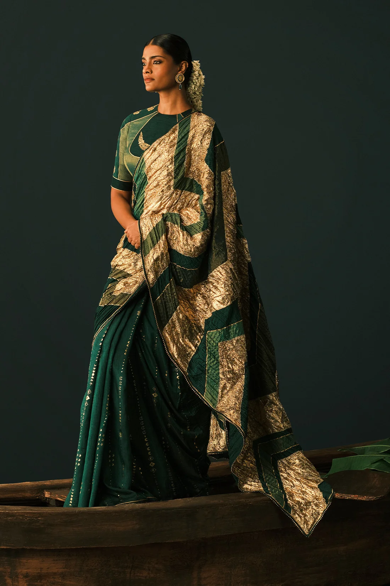

***House of Masaba Bottle Green Celestial Moonfall Crush Saree:*** [Shop Here](https://www.houseofmasaba.com/products/bottle-green-celestial-moonfall-crush-saree?_pos=1&_psq=Bottle+Green+Celestial+Moonfall+Crush+Saree&_psid=9f67614d6&_ss=e)

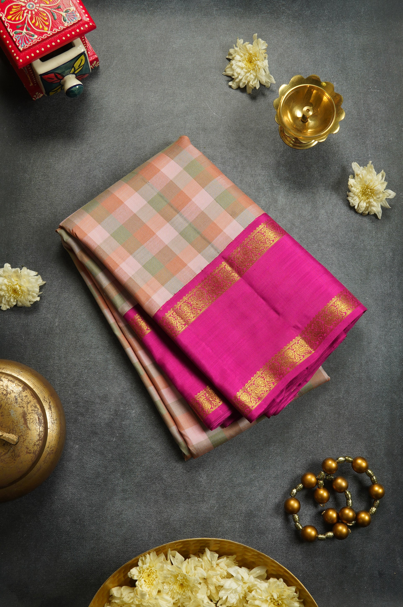

***Palam Silks Multicolored Checked Kanchipuram Silk Saree***: [Shop Here](https://www.palamsilk.com/products/multicolored-checked-kanchipuram-silk-saree-1?_pos=1&_sid=e2c500fad&_ss=r)

### **For Him: Restraint Is the Statement**

***Laromani Mustard Yellow V-Neck Short Kurta Set with Pitta Work for Men:*** [Shop Here](https://laromaniofficial.com/products/mustard-yellow-v-neck-short-kurta-set-with-pitta-work-for-men)

***Meghadri from Meluku:*** [Shop Here](https://meluku.in/products/meghadri)

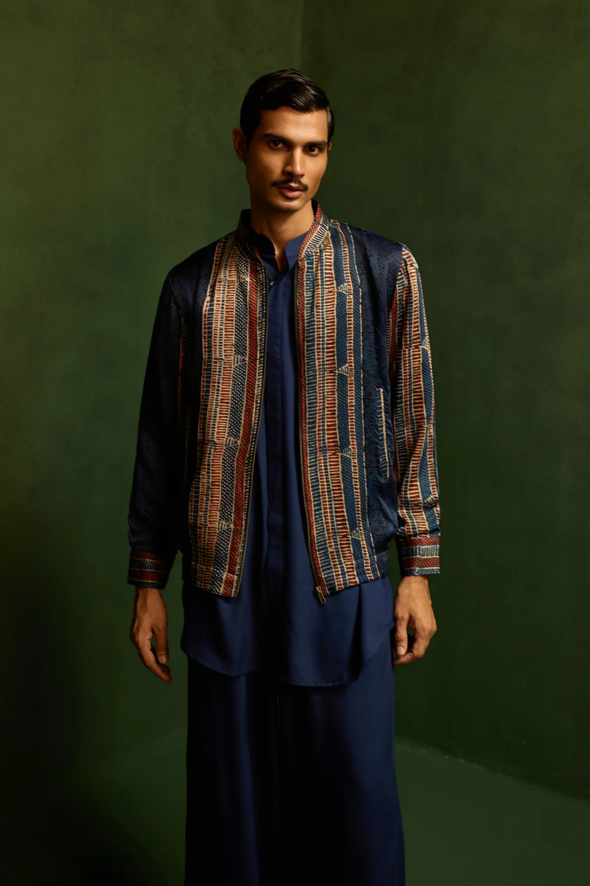

***October Ajrak indie bomber jacket:*** [Shop Here](https://www.octoberjaipur.in/products/ajrak-indie-bomber-jacket?_pos=1&_sid=2a3fe6eb5&_ss=r)

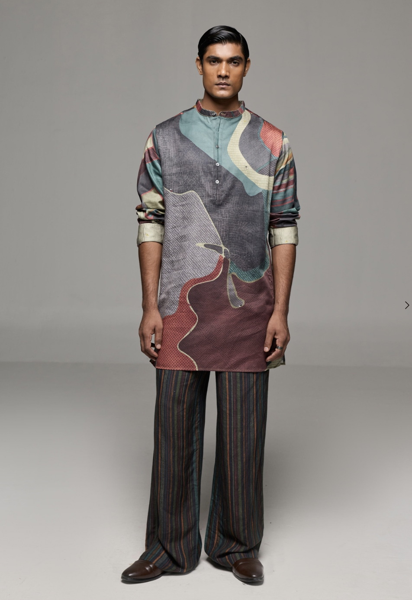

***Satya Paul Voyager Kurta:*** [Shop Here](https://satyapaul.com/product/voyager-kurta-96916239)

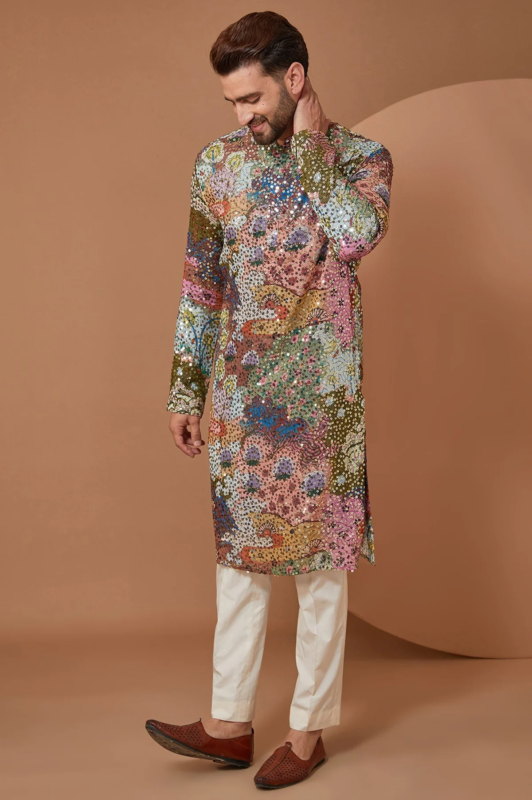

***Kasbah Men Abstract Sequin Embellished Kurta:*** [Shop Here](https://kasbahmen.com/products/abstract-sequin-embellished-kurta?_pos=1&_psq=Abstract+Sequin+Embellished+Kurta&_psid=bb6866419&_ss=e)

### **Accessories To Add**

***OPIUM+ SURI (Rose lens, Burgundy frame):*** [Shop Here](https://www.opiumeyewear.com/products/op-200017-c04-53-opium-suri-women-oval-uv-protection-sunglasses)

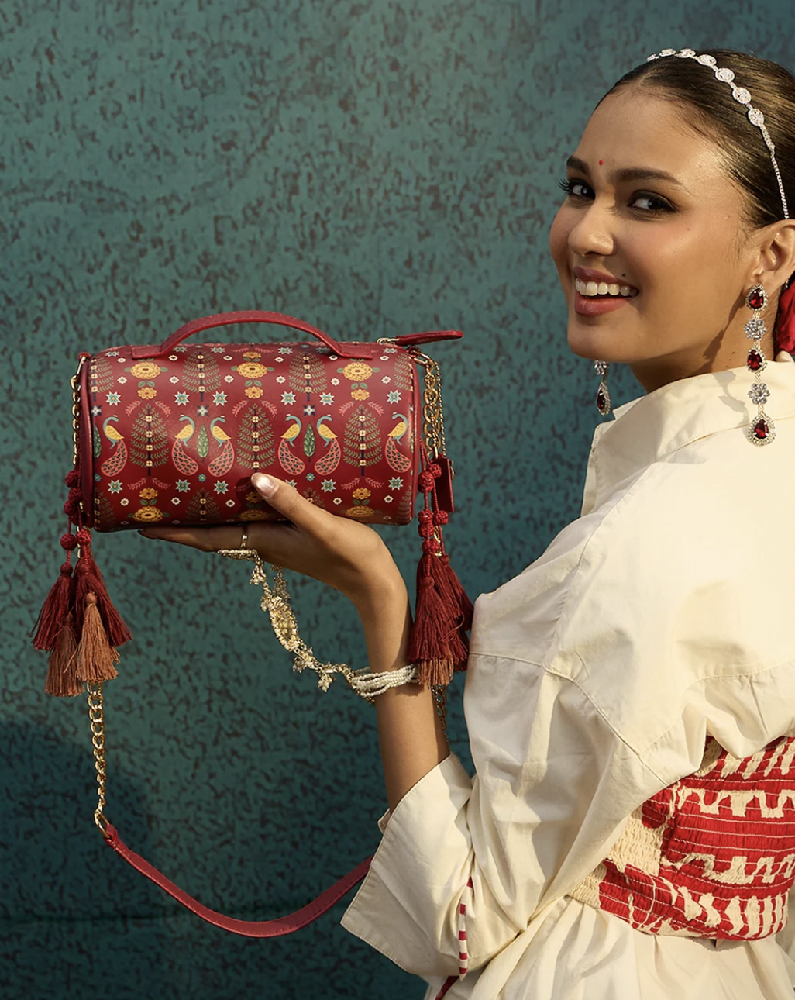

***Chumbak's The Patiala Sling Bag | Haveli Socials:*** [Shop Here](https://www.chumbak.com/products/the-patiala-sling-bag-haveli-socials)

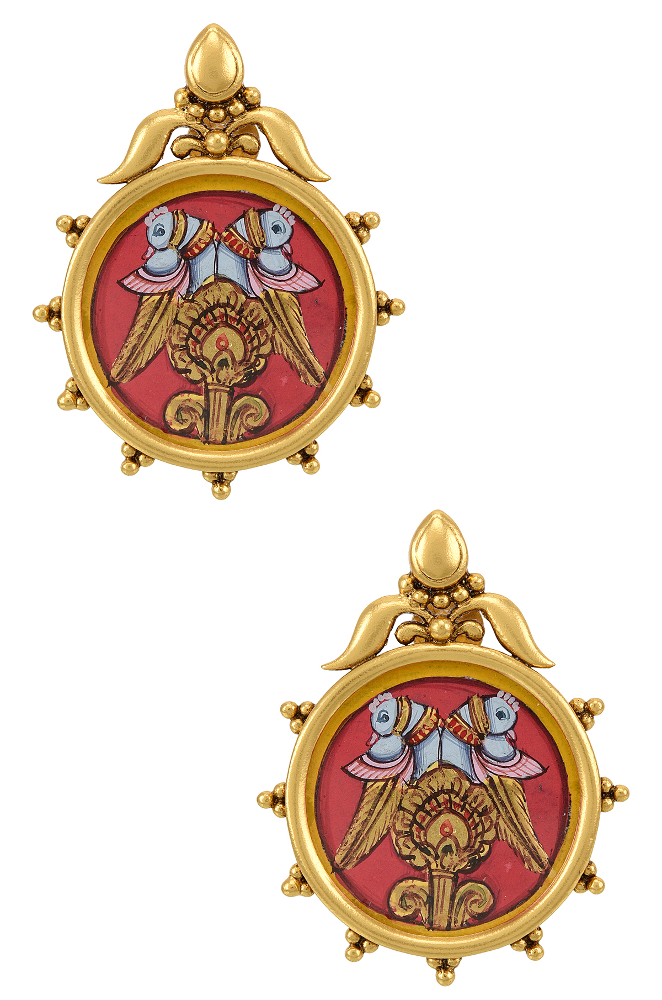

***Tribe Amrapali Mayur Thanjavur Painting Silver Lotus Ear Studs:*** [Shop Here](https://www.tribeamrapali.com/Mayur-Thanjavur-Painting-Silver-Lotus-Ear-Studs-RASE-5290?srsltid=AYCX9vLOoF8ervROCqD3uuVRHZy-_qdrNxmDJQFurmdOU9ROwU5x98Sv)

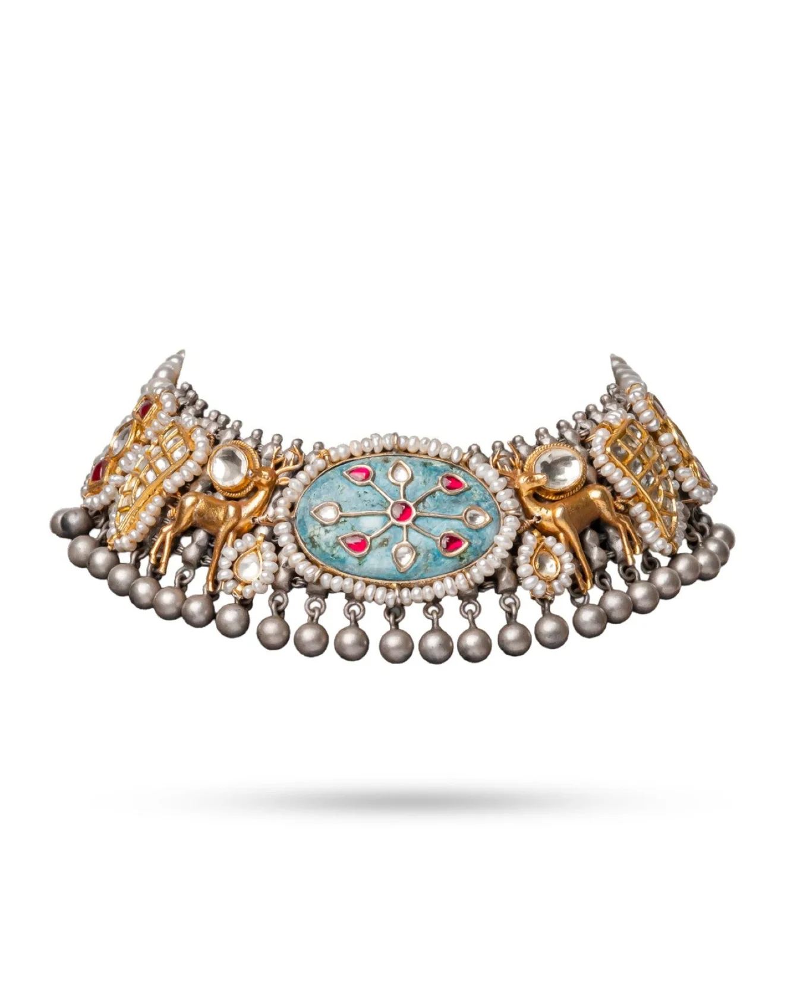

***Ministry of Good Souls 92.5 Celestial Grace Necklace:*** [Shop Here](https://www.mogs.store/products/925-celestial-grace-necklace?_pos=1&_psq=92.5+Celestial+Grace+Necklace&_psid=341f2a741&_ss=e)

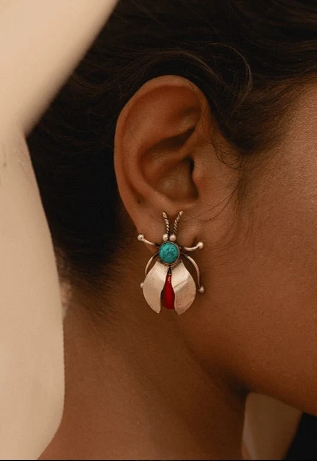

***Bhavya Ramesh Bug Earrings:*** [Shop Here](https://bhavyaramesh.com/products/bug-earrings?_pos=1&_sid=62553c63b&_ss=r)

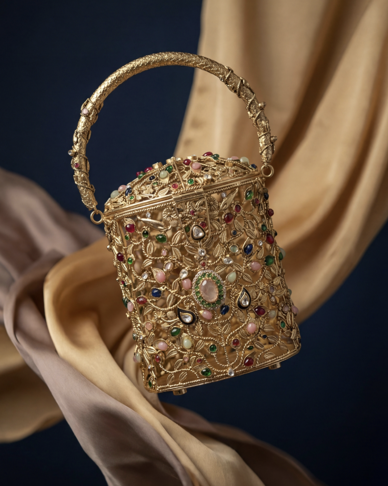

***The Ozel Bag- Limited Edition Filigree Bucket Bag:*** [Shop Here](https://shopozel.com/products/the-ozel-bag)

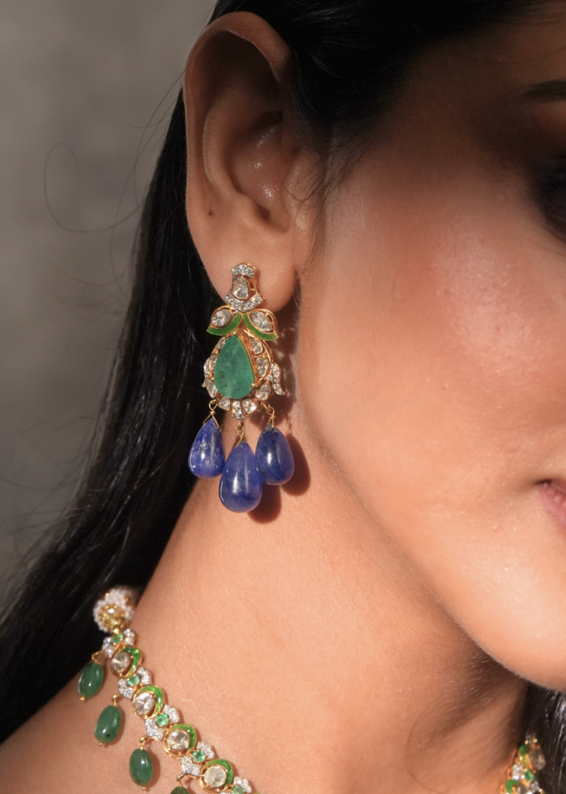

***Jacarti Nayesha Diamond & Polki Ear Rings:*** [Shop Here](<Nayesha Diamond & Polki Ear Rings>)

***Knot-Shaped Brass Cufflinks in Gold-Tone by Corneliani:*** [Shop Here](https://www.corneliani.com/en_ww/knot-shaped-brass-cuff-links-in-gold-tone-25tg52-2520514-035-uni.html#)

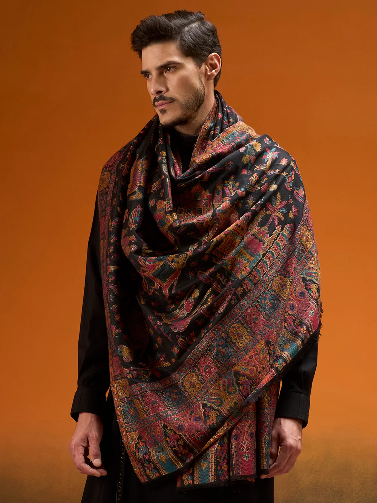

***Pashmoda Men Gulrukh Reversible Kaani Zari Shawl-*** [Shop Here](https://pashmoda.com/products/mzs-s-10-black?variant=46731228020897)

### **In Closing**

The most stylish people at any Diwali gathering are rarely the ones in the most elaborate outfit. They are the ones who look like themselves, only brighter. Choose the piece that makes you feel festive, wear it with ease, and let the light do the rest.

***Follow Best List India for the style, stories, and ideas worth paying attention to.***
