In a Marwari family, business is not a career choice so much as a native language. Yaash Jain grew up fluent in it: trust, long-term thinking, relationships, the quiet arithmetic of building something of your own. What he did with that fluency is the interesting part. Rather than step into an established family enterprise, he picked up a camera, and then built a business around it. Seven years and more than 200 weddings later, Click Click has developed a distinctive visual identity that sits between editorial photography and documentary storytelling, with global ambitions to match. We spoke to Jain about a creative language that arrived gradually rather than all at once, the difference between creating a photograph and capturing a moment, and what technology must never be allowed to replace.

**You grew up in a Marwari family where building a business was the natural order of things. Take us back to the moment you picked up a camera instead. What did you see that the family ledger could not offer?**

Growing up in a Marwari family, I was naturally exposed to business, entrepreneurship and the idea of building something of your own. It was an environment where business conversations, understanding opportunities and creating value were a part of everyday life. I always admired that mindset, but somewhere along the way, I discovered that my interests were drawn towards something more creative.

Photography introduced me to a completely different way of looking at the world. I started noticing things differently: the way light falls, the way people interact, the emotions behind a particular moment and the stories that unfold without anyone realising. What fascinated me most was the ability of a photograph to preserve something that could otherwise exist only as a memory.

I saw photography as more than just taking pictures. It was an opportunity to create something meaningful, something that people could revisit years later and still feel connected to.

I also realised that I could bring my entrepreneurial mindset into this creative world. Rather than simply pursuing photography as a passion, I wanted to build a business around it and create an identity of my own. That thought eventually became the foundation of Click Click.

**Choosing photography over an established family business is a quiet kind of rebellion. What did that conversation at home sound like, and what did it mean to have your family stand behind you?**

I wouldn’t describe it as a rebellion. For me, it was more about discovering my own direction and having the courage to pursue something I genuinely believed in.

Coming from a family where business was an established part of life, photography was certainly a different choice. But my family understood that I wanted to create something of my own. They were encouraging throughout the journey and gave me the freedom to explore this path.

Their support meant a lot, especially during the early stages when everything was new. Starting a business in a creative industry involves learning several things simultaneously: understanding the craft, finding clients, building relationships and figuring out how to turn a passion into a sustainable business.

I was fortunate to have a family that believed in my decision. Their encouragement gave me the confidence to take that first step, while the values I had grown up with gave me a strong foundation.

I think one of the most beautiful things about building your own path is being able to carry the values you inherit while creating something that is uniquely yours. That’s something I have always been grateful for.

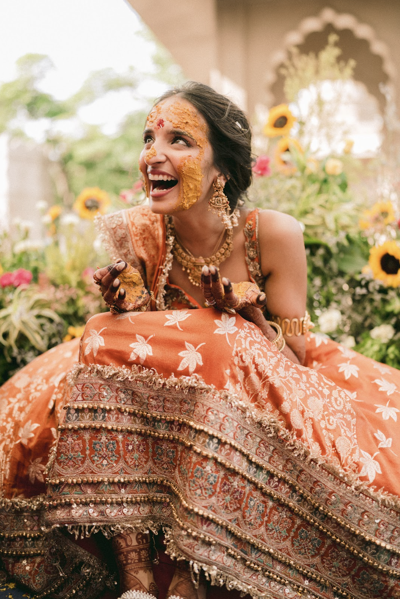

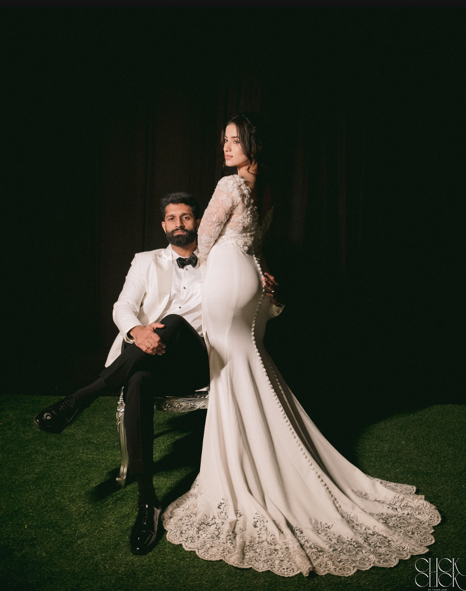

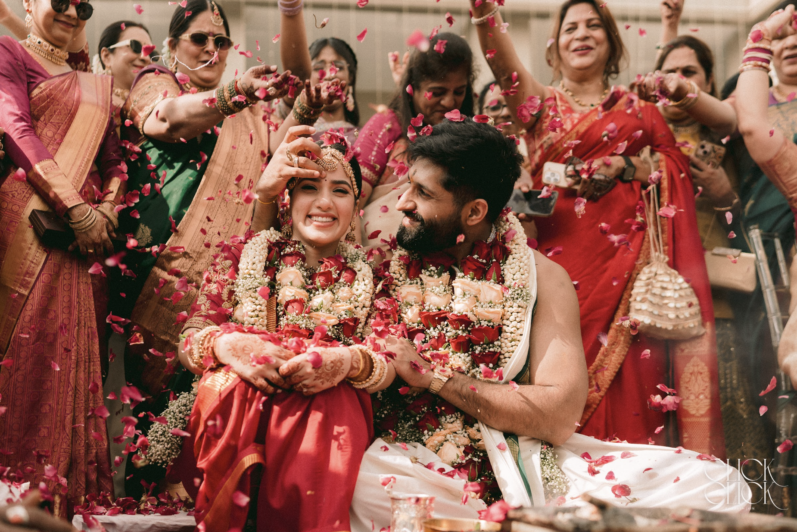

**Seven years, over 200 weddings. Before there was a signature, there was a blank page. How did you build a creative language from scratch, and when did you first recognise it as your own?**

When I started, I didn’t have a predefined creative formula or a particular style that I wanted to replicate. I was constantly exploring, learning and understanding what I connected with visually.

I have always been interested in different forms of visual storytelling, particularly editorial photography, contemporary fashion, cinema and documentary filmmaking. I would observe how different photographers and filmmakers approached light, composition, movement and emotions. Gradually, I started understanding what appealed to me and how I wanted to interpret those influences through wedding photography.

I think the creative identity of Click Click has developed organically over the years. Every wedding has taught us something new. Every couple brings a different personality, every location offers a different visual possibility and every celebration presents an opportunity to experiment.

There wasn’t one particular moment when I felt we had found our signature. It was more of a gradual realisation that our work was beginning to reflect a consistent perspective.

Today, after seven years and over 200 weddings, I feel our approach has become much more defined. We look at weddings through an editorial lens while remaining deeply connected to documentary storytelling. For me, the most important thing is that our work continues to evolve without losing the visual identity we have built.

**You draw from editorial photography, contemporary fashion, documentary storytelling and cinema. Where do these worlds meet inside a single frame at a wedding?**

I think weddings are one of the most exciting spaces for visual storytelling because they naturally bring together so many different elements.

Editorial photography influences how we approach composition, light, styling and the overall visual balance of an image. Contemporary fashion brings an understanding of movement, individuality and aesthetics. Documentary storytelling teaches us to observe and recognise moments as they unfold, while cinema introduces the idea of building an atmosphere and creating a narrative.

For me, these influences come together quite naturally at a wedding.

A beautifully composed bridal portrait might have an editorial quality, while an emotional exchange between family members might be approached entirely through documentary photography. A wide cinematic frame of the celebration could bring all these elements together through atmosphere, scale and movement.

The challenge, and also the beauty, lies in knowing when to use each approach.

I don’t want a wedding to feel like a photoshoot. It should remain a celebration that people experience naturally. Our job is to find the visual possibilities within that experience and translate them into photographs and films that feel both artistic and authentic.

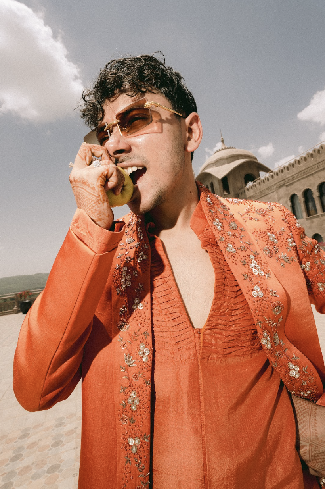

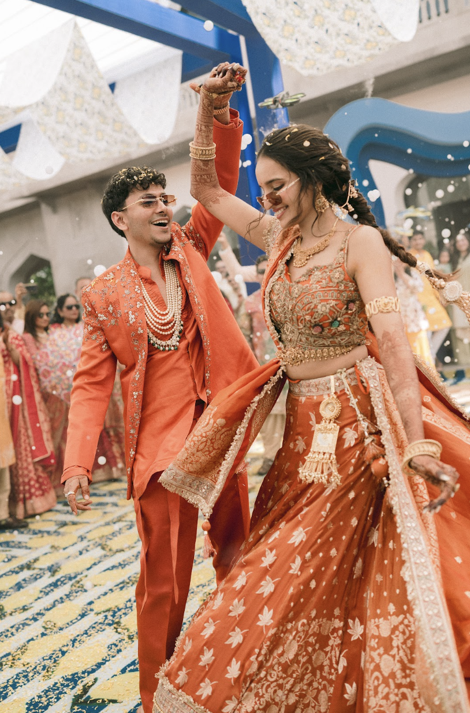

**Every couple is asked to arrive without a template. What do you need to learn about a bride and groom before you can decide how their wedding should look on camera?**

For me, understanding the couple is the starting point of every wedding.

Before thinking about locations, compositions or photographs, I want to understand who they are as individuals and what their relationship looks like. How do they interact with each other? Are they expressive or reserved? What makes them comfortable? What kind of experiences do they enjoy?

I also like understanding their families, cultural backgrounds and the significance of different wedding traditions. In Indian weddings, the family plays such an important role, and often there are several beautiful relationships and stories unfolding alongside the couple’s own journey.

These conversations help us understand what matters most to them.

Some couples want something very editorial and contemporary, while others prefer a more understated and documentary approach. There are couples who enjoy being in front of the camera, and there are others who simply want to enjoy their celebrations without feeling conscious of it.

We try to adapt our approach accordingly. I don’t believe in making every wedding look the same. The idea is to create a visual story that reflects the couple’s personality, their relationship and the atmosphere of their celebration.

**Weddings are loud, crowded and unrepeatable. How do you find the quiet exchange inside the grandest celebration, and which one has stayed with you the longest?**

I think the most important quality a wedding photographer develops over time is the ability to observe.

At a wedding, there is always something happening. There are elaborate celebrations, performances, ceremonies and hundreds of people interacting with each other. While all of that is important, some of the most meaningful moments happen in between.

It could be a father looking at his daughter during a ceremony, a mother adjusting her child’s outfit, siblings sharing a spontaneous laugh or a couple exchanging a glance in the middle of a busy celebration.

These moments are rarely planned. You have to be attentive enough to recognise them and understand when to capture them.

I find it difficult to identify just one moment that has stayed with me because every wedding leaves behind a different set of memories. But the moments involving parents and families have always been particularly meaningful to me. There is something very special about documenting the emotions of people who have been a part of a couple’s journey long before the wedding day.

I think that’s what makes wedding photography so rewarding. Sometimes, the photographs that become the most precious to a family are not the ones they expected us to capture. They are the little moments they might not even have noticed at the time.

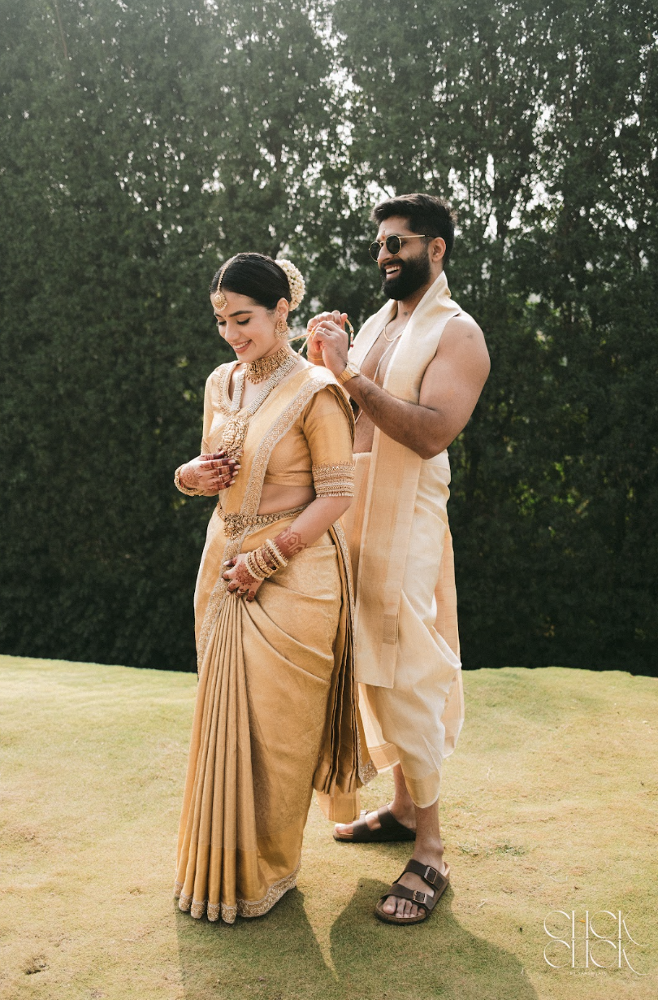

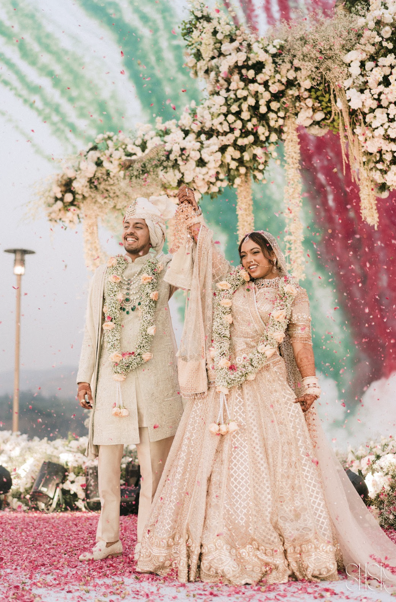

**Editorial and authentic are not always easy companions. How do you direct a moment without taking it away from the people living it?**

I believe direction should enhance a moment rather than take control of it.

There is definitely a place for direction in wedding photography. When creating portraits, especially editorial-style photographs, small adjustments in movement, posture, composition or positioning can make a significant difference to the final image.

But there is an equally important side to our work where we simply observe and allow people to be themselves.

The key is understanding the difference between creating a photograph and capturing a moment. Both are important, but they require different approaches.

When we are photographing couples, we try to create an environment where they feel comfortable rather than making them feel like they are constantly performing for the camera. The more relaxed they are, the more naturally their personalities come through.

I think an editorial photograph can still be incredibly authentic. It doesn’t have to feel staged or disconnected from reality. It is simply about bringing a certain visual intention to the way a moment is framed.

At the end of the day, I want couples to look at their photographs and recognise themselves in them. The aesthetics should add to the experience, never take away from it.

**You are curious about AI and wearable technology. How do you imagine a family will relive a wedding in twenty years, and what must technology never be allowed to replace?**

I find the relationship between technology and photography extremely exciting. The way we create, organise, preserve and experience photographs is changing rapidly, and I think the wedding industry has a lot to explore in this space.

AI already offers interesting possibilities in areas such as image organisation, post-production, archiving and making large collections of photographs easier to revisit. Wearable technology could also introduce new perspectives and ways of documenting experiences.

I imagine that twenty years from now, families may be able to revisit their weddings in much more immersive ways. Beyond looking through photographs or watching a film, they might be able to explore different perspectives, revisit specific moments and experience parts of the celebration in ways we are only beginning to understand today.

However, I believe technology should always enhance the creative process rather than replace the human element behind it.

A meaningful photograph is not simply the result of having the right equipment or using the latest technology. It comes from understanding people, recognising emotions and knowing when a moment is worth preserving.

I am always interested in exploring new tools that can improve our work and the experience we offer our clients. But the one thing technology should never replace is the human ability to connect with a moment and understand its emotional significance.

Technology may change how memories are preserved, but the emotion behind them must always remain real.

**You have said that building your own path does not mean leaving your roots behind. How do the values of a business family show up in the way you run a creative studio?**

My upbringing has had a significant influence on the way I approach Click Click as a business.

Growing up in a Marwari business family, I was exposed to values such as trust, commitment, relationship-building and long-term thinking from an early age. These are principles that I continue to apply in the way I work and manage the company.

I believe that running a creative business requires much more than having a good creative vision. You need to understand the business side, build a reliable team, maintain strong relationships and create systems that allow the company to grow sustainably.

At Click Click, we want to maintain a balance between creative freedom and professional discipline. Every wedding is an important responsibility, and the trust clients place in us is something we value immensely.

I also believe that relationships are at the heart of any successful business. Whether it is with clients, wedding planners, collaborators or our own team, building genuine and lasting relationships is extremely important.

In many ways, I haven’t moved away from the values I grew up with. I have simply applied them to a different industry and built a business around something I am passionate about.

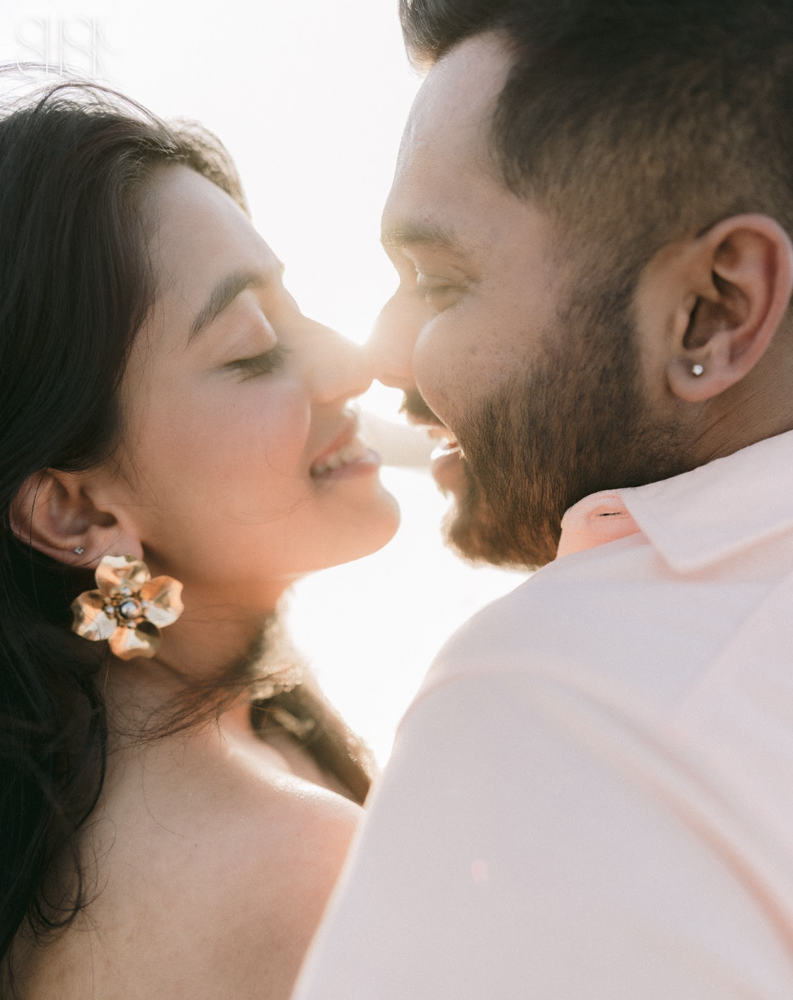

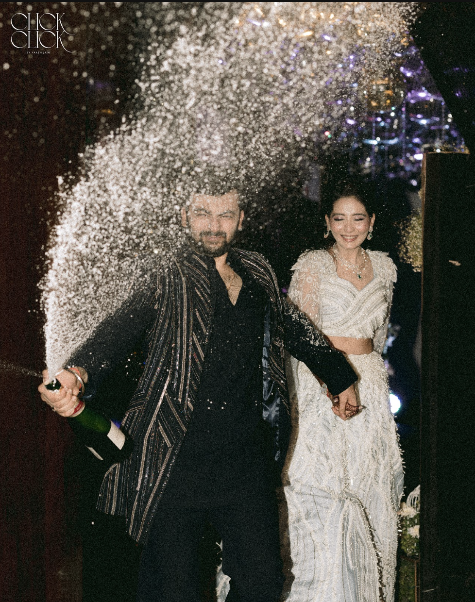

**You want Click Click to become a globally recognised creative brand, not just a wedding studio. What does that world look like, and what is the one idea you will never compromise on to get there?**

My vision for Click Click is to build a globally recognised luxury wedding photography and filmmaking company, known for its distinctive visual identity, creative approach and quality of storytelling.

I want Click Click to work across different countries and cultures, documenting weddings at some of the world’s most beautiful destinations while bringing our own perspective to every celebration.

For me, building a global brand is not just about expanding into different markets. It is about establishing a reputation where couples and wedding professionals across the world recognise the name and associate it with a certain standard of work.

India has an incredibly rich wedding culture, and I believe there is immense potential for Indian wedding photography companies to establish themselves internationally. I want Click Click to be among the names that contribute to that journey.

Over the coming years, I want to continue strengthening our presence in the destination wedding space, building relationships with international planners and expanding our work across different parts of the world.

But as the company grows, I never want us to lose our creative identity or the personal approach we bring to every wedding. Trends will evolve, technology will change and the industry will continue to move forward, but thoughtful storytelling and authentic emotions will always remain at the centre of our work.

Ultimately, I want Click Click to become a name that couples across the world recognise and trust to document one of the most important chapters of their lives.

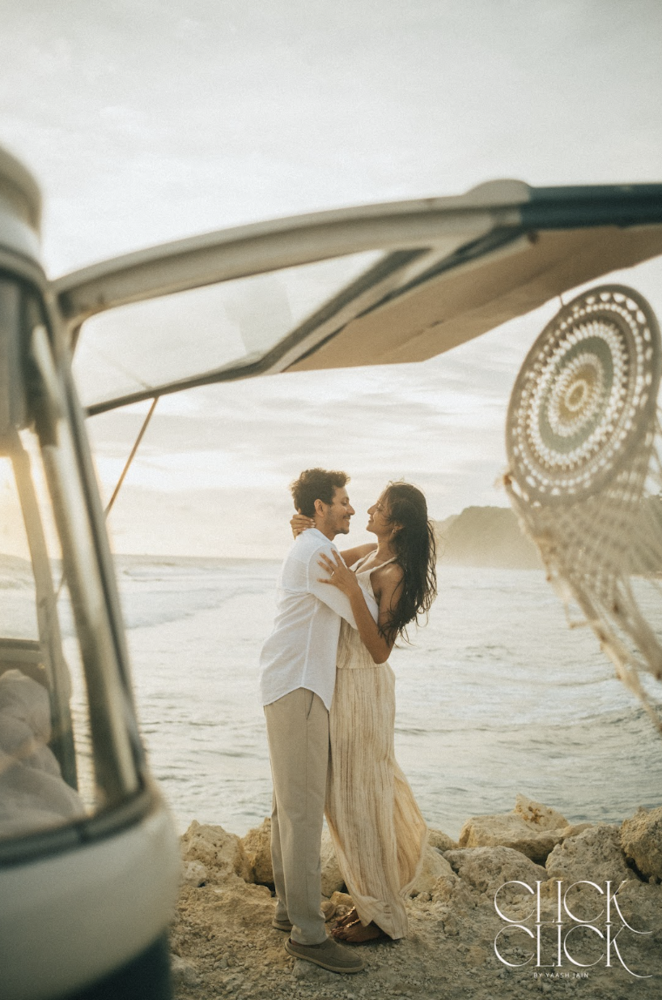

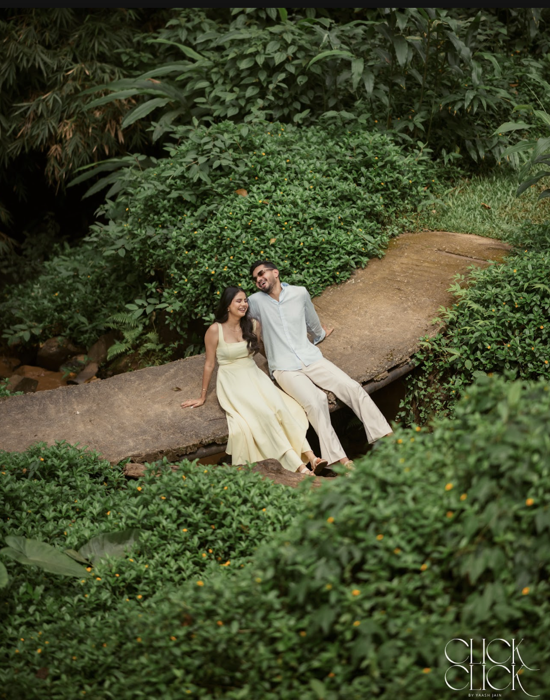

*What makes Yaash Jain’s story satisfying is how little of it is rebellion. He did not reject the family business so much as translate it: the Marwari instincts for trust, patience and long-term relationships now run a studio whose product is feeling. The result is a founder who speaks as comfortably about systems and sustainable growth as he does about the way light falls on a father’s face during a ceremony. As weddings grow larger and technology promises ever more immersive ways to relive them, Jain’s position is refreshingly steady: use the tools, but protect the human ability to recognise a moment that matters. If Click Click becomes the globally recognised name he is aiming for, it will be because that discipline held.*

***Follow Best List India for the food, stories, and ideas worth paying attention to.***
