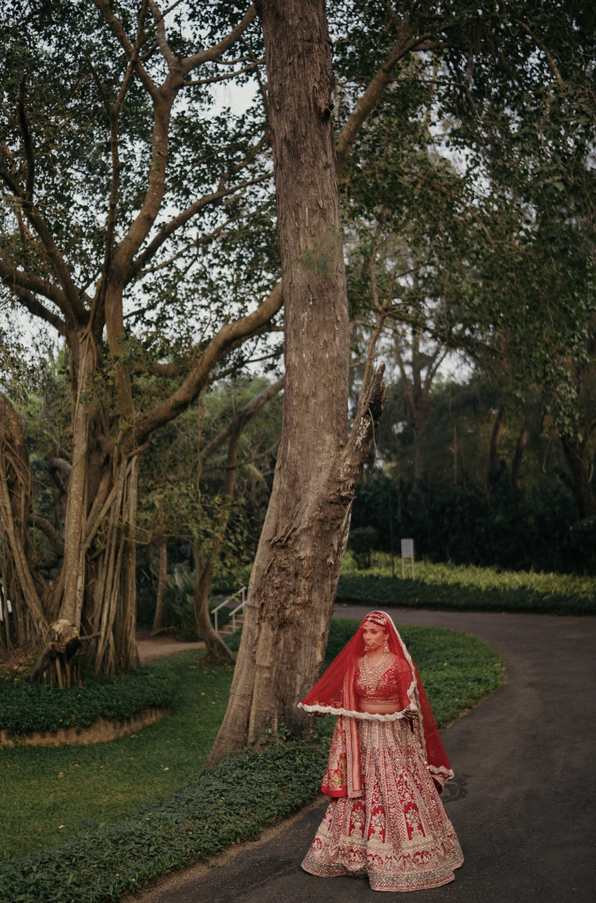
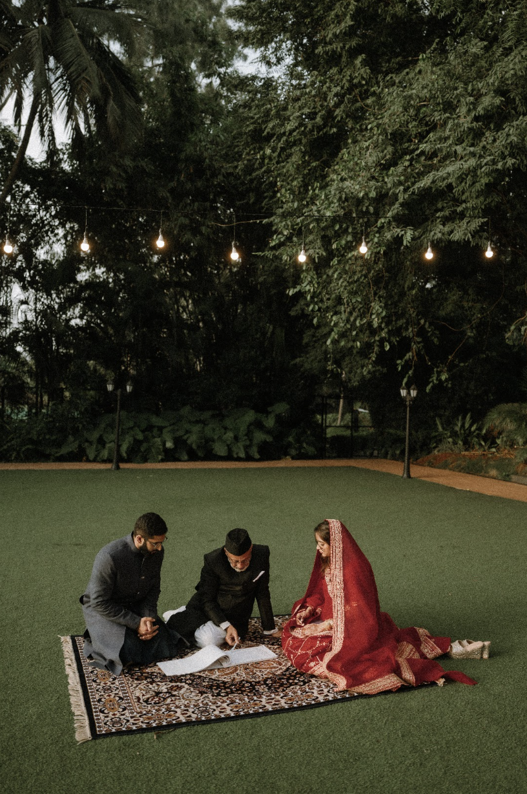
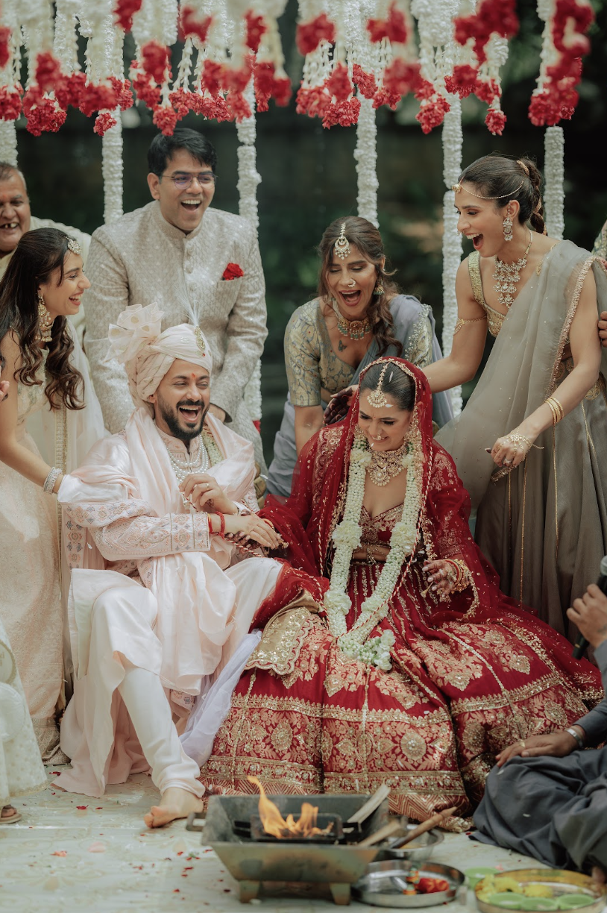
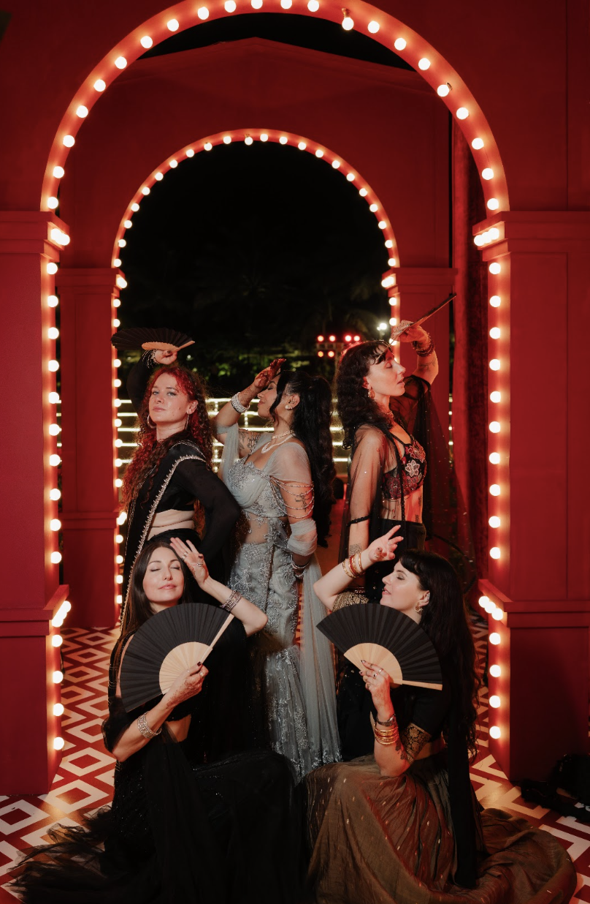
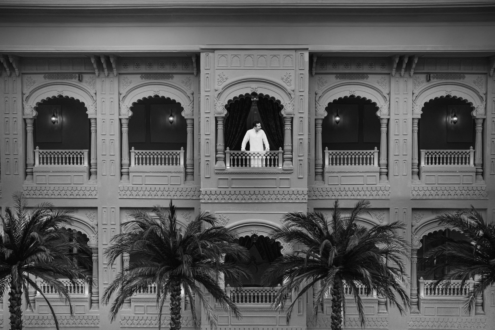
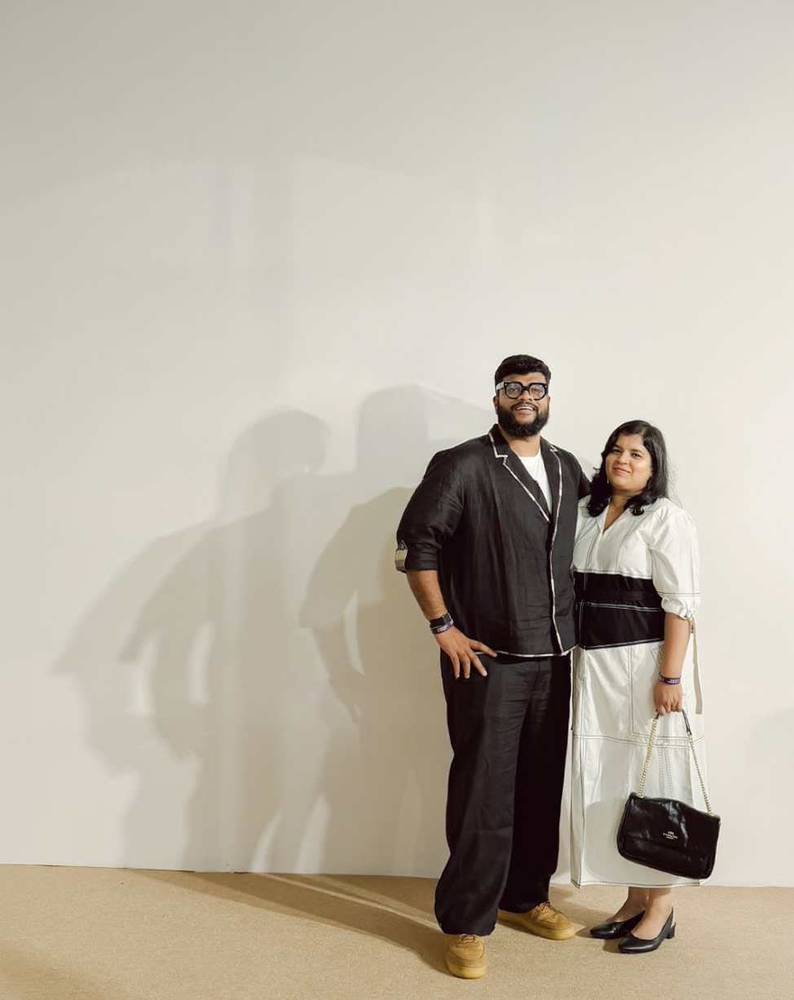

In 2014, while pursuing his Bachelor’s degree in Bangalore, Abhiram Rajan bought his first camera on a credit card, despite earning less than the price of the camera itself. To most people, it felt impulsive. To him, it felt necessary.

What began as curiosity soon became something deeper. Between college, a full-time corporate job at Aon, and long weekends spent photographing anything he could, from office events and portraits to nightlife, birthdays, food, and people, photography slowly became more than a passion. It became direction. Then came his first wedding, and with it the realisation that photography could be larger than visuals: it could preserve emotion, relationships, chaos, energy, and the deeply human moments people never want to forget.

Somewhere within that journey, The Shutterbug Film Company quietly began taking shape. Founded in 2018, it has since grown from one person with one camera into a wedding photography and filmmaking company with teams across Bangalore, Mumbai, and Dubai, work in more than 90 cities, and over 37 honours, including Green GIWA’s Overall Best Photographer and a place on the 35 Under 35 list.

Alongside him since the beginning is Payal, the studio’s co-founder and the business mind behind its creative work. She began her career in audit and accounting in Mumbai, holds a commerce degree and a master’s in business law, and has spent more than a decade across finance, compliance, and corporate law, building finance functions from the ground up at fast-growing startups and guiding one through multiple rounds of venture funding. While the team behind the camera focuses on the craft, Payal looks after finances, contracts, structure, and long-term planning, and leads the networking and relationships that have built the studio’s partnerships with couples, families, planners, and venues.

We spoke with Rajan about passion without calculation, the first wedding that turned out to be the beginning of everything, and what it takes to protect honesty in the work as a studio grows.

**You bought your first camera on a credit card while earning less than it cost. What did you see in that moment that others did not?**

Honestly, I did not see any business. I did not see a company, or teams, or cities. I saw something I could not stop thinking about. People sometimes ask whether it was a calculated risk, and the truth is there was no calculation at all. It was pure passion.

Looking back, I think that is exactly why it worked. Passion does not sit down and do a cost-benefit analysis; it just refuses to let go of you. If I had waited for the moment when buying that camera made financial sense, that moment would never have come, and Shutterbug would not exist.

I did not know then that I would one day be heading a company. I only knew that holding a camera felt like the most natural thing in the world, and that I would rather be in debt doing something I loved than comfortable doing something I did not. Sometimes the most important decisions in your life are the ones that make no sense on paper.

**Your first wedding changed everything. What do you remember most about that day, and what did you get wrong?**

It was a very traditional Kannadiga wedding, and it turned out beautifully. I was still learning, still figuring out where to stand and when to move, but something about that day just clicked.

What I remember most is walking in thinking I was there to do a job and walking out knowing I had found my calling. That shift happened somewhere in the middle of the rituals, watching two families come together, and realising that I was the one who would hold on to these moments for them.

One of the videographers I shot with that day still works with me today. So in a way, Shutterbug’s first team came together at that wedding, before Shutterbug even had a name. If I got anything wrong, it was thinking it was just one wedding. I treated it as a single assignment, when really it was the beginning of everything that followed.

**You say you want to preserve how a moment felt, not just how it looked. What does that mean when you are standing in the middle of a chaotic baraat?**

I have always believed photographs and films can carry emotions that words simply cannot. And the strange thing about big moments is that the people inside them rarely see them. They are too busy living them.

A baraat is loud, wild, and gloriously chaotic, and on the surface everyone sees the dancing, the dhol, the crowd. But inside that chaos there are quieter truths: a cousin who is happier for you than you have ever seen them, friends who have been waiting years to dance at your wedding, a parent watching from the edge with tears they will deny later.

Anyone can photograph what a baraat looks like. Our job is to find the depth inside the noise. That means watching faces more than movement, and waiting for the half-second where someone’s guard drops. Years from now, the couple should not just remember that it was a great party. They should remember how loved they were.

**In an industry moving toward trends and replication, what do you refuse to copy?**

I refuse to let a trend decide how someone’s story is told. We are a wedding photography and filmmaking company, and I think it is important to remember what that means. Trends are fun, and there is nothing wrong with enjoying them, but they have an expiry date. A wedding album does not.

The real test of our work is not whether it looks current next month on social media. It is whether it still moves you twenty years from now, when you are showing it to your children. Once the day is over, everyone is eager to see the things they could not see while they were living in it. Those are the images that get remembered in the long run, and they do not become valuable because they followed a format. They become valuable because they were honest.

So we stay curious about what is new, but we curate for what is timeless.

**You have grown from one person with one camera to teams across Bangalore, Mumbai and Dubai. What has been hardest to protect as you scaled?**

Authenticity, without a doubt. When you grow, the easiest thing to lose is the very thing that made people come to you in the first place. In an industry where so much work has started to look the same, I have always fought to protect our identity. I want someone to look at a frame and know it is Shutterbug without seeing a logo anywhere.

That becomes much harder when it is no longer just you behind the camera, because now the challenge is passing a way of seeing on to other people, not just a technique.

That said, protecting authenticity does not mean standing still. We are not afraid of challenges. We love experimenting, trying new approaches, and evolving with every season. But evolution only works if you are clear about what you are not willing to change, and for us, that is the honesty in the work.

**With more than 37 honours, including Green GIWA’s Overall Best Photographer and the 35 Under 35 list, which recognition meant the most, and why?**

Green GIWA. It is one of the toughest awards in our industry, and it recognises the best wedding photographers across Asia. To be named among that calibre of talent is something I never imagined when I bought that first camera on a credit card.

As an artist, there is something deeply meaningful about being recognised by your peers. Clients love your work because of how it makes them feel, but the people in your own craft understand exactly what went into every frame: the timing, the instinct, the hours. When that recognition comes from within the industry, at such a level, it tells you that what you have been quietly believing about your work actually holds up on the biggest stage.

It also is not mine alone. Every award belongs to the team that stood beside me through every wedding that led there.

**You now shoot across 90+ cities. What has working across cultures taught you about how people celebrate?**

That language barriers do not really exist at a wedding. I have stood in rooms where I did not understand a single word being spoken, and it did not matter, because the only language in the room was love, and everyone speaks it fluently.

A wedding is not just a ceremony; it is a festival. The rituals change from city to city, the music changes, the food, the colours, the order of events, but the feeling underneath is always the same. It is one of the rare times in life when everyone you love is under one roof at the same time. Most people get that only a handful of times in their entire lives.

Working across cultures has taught me to walk in with curiosity instead of assumptions, and to respect every tradition as someone’s whole world. And being trusted to document that is the biggest privilege of this work.

**Finish the sentence: a great wedding film should always...**

...be uniquely you. It should be your story, told the way the day actually felt.

Every couple is different, and their film should be too. It should capture the essence of the day as it truly was, the laughter, the nerves, the chaos, the quiet in-betweens, without forcing it into someone else’s idea of a perfect wedding. When a couple watches their film and says that is exactly us, we have done our job.

**You have built Shutterbug alongside your life partner. How sustainable is it to share both a life and a business?**

People assume the hard part is not bringing work home. But honestly, the real advantage is that we never have to explain the vision to each other. Two minds working on the same thing, from different angles, gives the brand a stability that is hard to build any other way.

When you operate at this scale, across cities and teams, clients need to feel that there is a steady hand behind everything, and years of handling clients together have taught us how to be that.

What makes it work is that our differences are actually our strength. I am very impulsive and love taking risks, and a lot of our growth has come from that courage to say yes before we were fully ready. Payal’s role is to hold everything together so those bold leaps land safely. I push us forward; she makes sure we have ground to stand on.

Of course there are days when work and life blur together, but that is also what makes it meaningful. It works because we are building the same dream, not competing for it.

**The Other Half of the Studio**

Wedding photography is often seen as a purely creative field. Payal represents the other half of what makes a studio last: sound finances, clear contracts, and relationships built on trust. Since 2018, she has turned what began as a passion project into a sustainable business, and the partnerships that carry The Shutterbug Film Company from city to city, with couples, families, planners, and venues, are ones she has built and kept.

It is a fitting counterpart to a founder who began with a camera he could not afford and a conviction he could not explain. One of them said yes before the studio was ready. The other made sure it was.

***Follow Best List India for the culture, conversations, and ideas worth paying attention to.***
