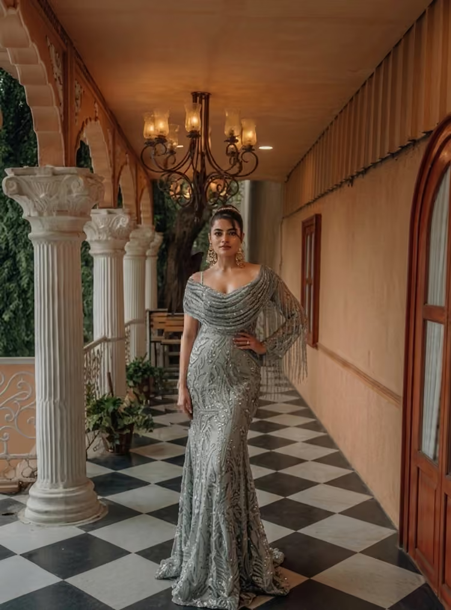
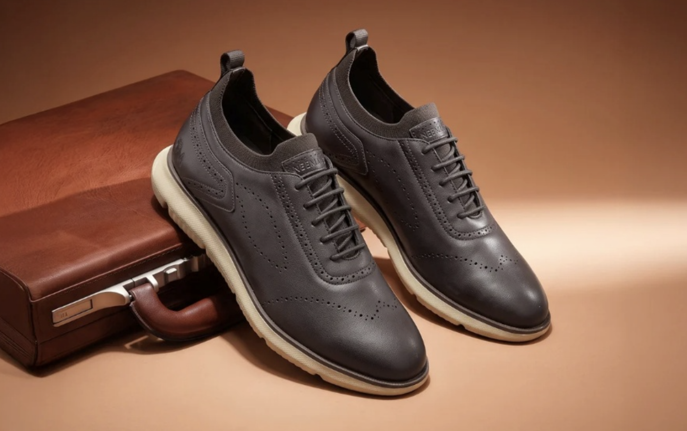
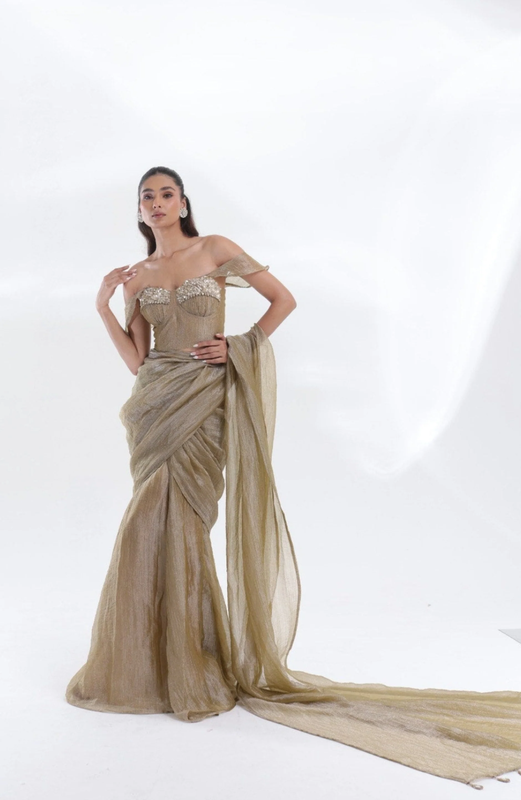
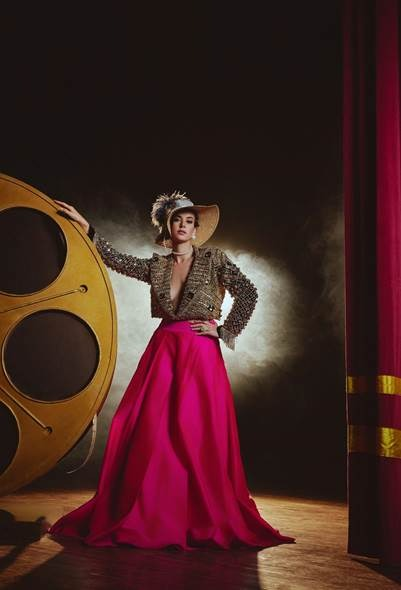
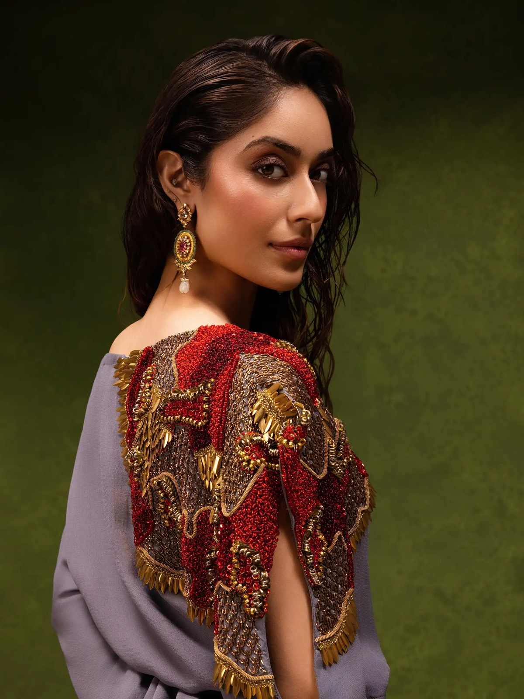
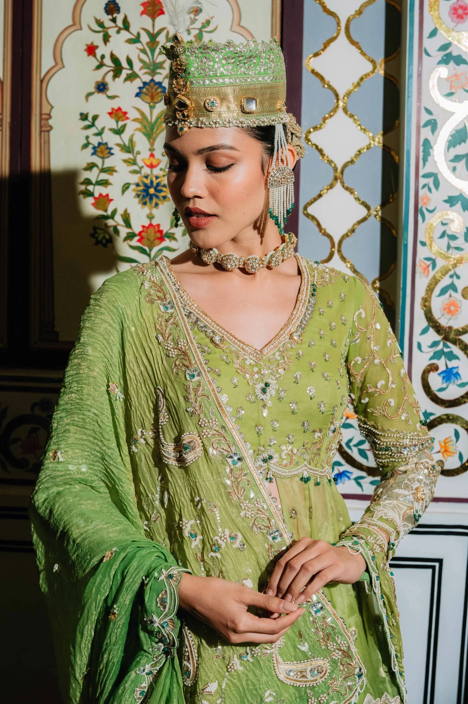
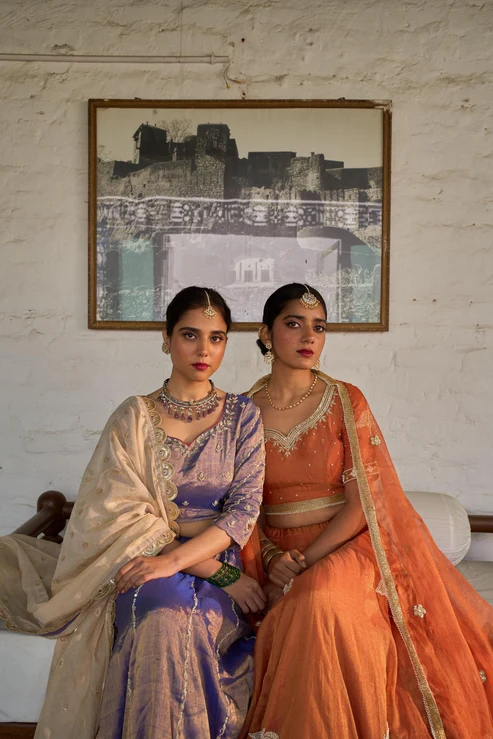
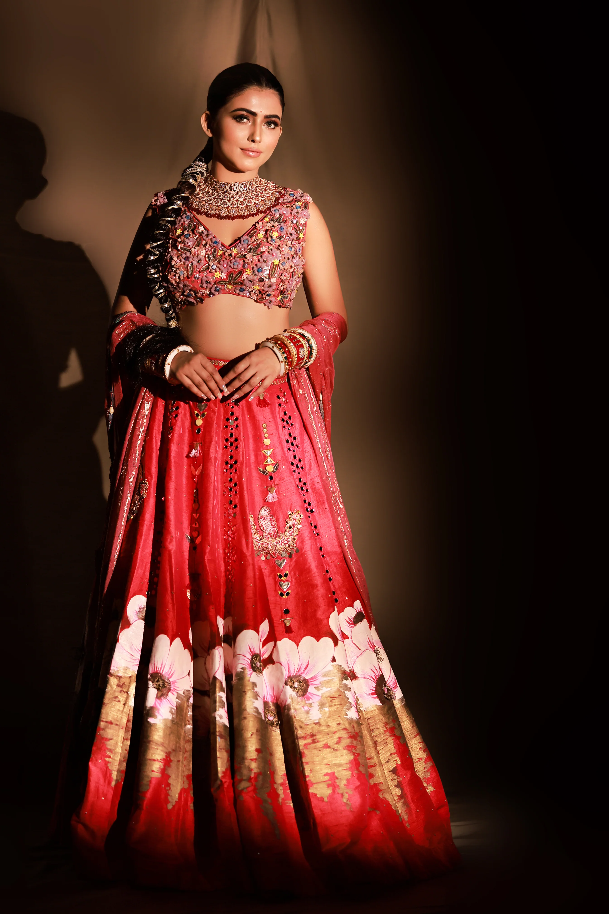
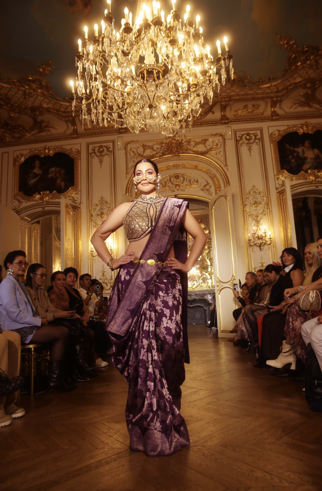

For a long time, Indian craft lived in a slightly awkward category. It was admired, certainly, and often sincerely. But it was admired the way a heritage monument is admired: from a respectful distance, with a plaque, as something that belonged to the past and needed protecting from the present.

That posture is changing. Across fashion, jewellery, accessories and the home, a generation of designers has stopped asking how to preserve craft and started asking what it can do. The question has moved from conservation to conversation. And the answers are producing some of the most confident, most distinctive design coming out of India in decades.

This is the craft renaissance. It is less a revival than a reorientation: the moment a tradition stops being treated as heritage and starts being used as a language.

#### **Labels Championing The Craft**

**Diksha Mahajan** is a couture label specialising in bridal and trousseau wear. Founded by designer Diksha Mahajan, the brand draws inspiration from the tradition of passing down wedding sarees and lehengas across generations. This idea of clothing as a personal keepsake forms the foundation of its design philosophy. Its collections include lehengas, sarees, skirts, cocktail gowns and other occasionwear, catering to modern brides and women dressing for special celebrations. The label places emphasis on carefully selected fabrics, individual preferences and personal detailing, creating outfits that carry an emotional connection beyond current fashion trends.

**Bonsoir** is a men's fashion brand with over 28 years of experience, founded in Delhi and now operating out of Noida. The brand brings together traditional Indian craftsmanship and contemporary tailoring across its range of formal and occasionwear, including kurtas, jackets, Bandhgalas, suits, blazers and sherwanis.

Rooted in heritage craftsmanship, Bonsoir works closely with skilled local artisans and craftsmen, with a focus on intricate motifs, hand embroidery and detailed craftsmanship. By bringing traditional techniques together with modern silhouettes and refined tailoring, the brand continues to explore new interpretations of Indian menswear for the modern man.

At **Neeman’s,** craftsmanship is an expression of thoughtful design, where every detail is informed by the way people move, live and experience comfort. Founded in 2018, the brand was born from a simple yet compelling question: *why couldn’t good-looking shoes be comfortable too?*

This curiosity evolved into a design philosophy shaped by material exploration, ergonomic precision and functional innovation. Drawing on the nuances of Indian foot anatomy, we approach footwear through an understanding of natural movement and the way feet interact with different surfaces. Every contour, cushioning element and structural detail is thoughtfully engineered to deliver flexibility, adaptability and lasting support. 

Our interpretation of craft is equally reflected in our choice of materials – bringing together the natural finesse of Merino wool and organic cotton with recycled PET-derived fibres and recycled rubber. We also draw from India's rich textile traditions. The [कला Kicks](https://neemans.com/products/klaa-kicks-for-men-tan?srsltid=AYCX9vI5RFlhKhKnkjDMTfiAsC0io_1Y5a8c0FomRBKgE8UQr5thU01c) collection reinterprets the distinctive running stitches of Kantha embroidery through contemporary footwear, while the knitted constructions across [Begin Walk](https://neemans.com/collections/begin-walk-collection), [Knit Gliders](https://neemans.com/search?q=Knit+Gliders+collection) and [90s Retro](https://neemans.com/products/the-90s-duo-sneakers-for-men-black-ivory?_pos=1&_sid=c3447361a&_ss=r) collections translate textile-inspired techniques through modern technology and material science.

At Neeman’s, artistry resides as much in the visible as in the experiential. Through considered silhouettes, intelligent construction and an interplay of form and function, we bring traditional influences into a contemporary design context, where every detail serves a purpose and comfort becomes a design language in itself.

**Deepanshi Massey** is an Indian occasionwear label specialising in contemporary Indian ensembles. Its collections focus on concept sarees, lehengas and shararas, with designs that bring together statement detailing and modern silhouettes. The label offers a range of outfits for weddings, festive occasions and celebrations, with an emphasis on contemporary interpretations of traditional Indian dressing. Its product range includes embellished sarees, pearl-detailed ensembles and statement lehengas. The brand also offers customization on select pieces, allowing customers to make adjustments according to their preferences. Deepanshi Massey caters to women looking for occasionwear that combines traditional dressing with a more contemporary aesthetic.

Indian craftsmanship has long been defined by its richness, intricate detailing and regional textile traditions. With her latest collection, **‘Bombay से Beyond – Postcard to Reality**’, designer Maheka Mirpuri has brought these elements into a contemporary couture context, drawing inspiration from the glamour, elegance and old-world sophistication of Bombay.

Rooted in the designer's nostalgia for a bygone era, the collection explores how traditional Indian textiles and artisanal detailing can be reinterpreted through modern silhouettes. At its heart Maheka's ‘Bombay Begum’ is a woman who embodies grace, confidence and understated royalty. Her wardrobe brings together sculpted silhouettes, cinched waists and corsets with pearls, vintage-inspired jewellery and intricate embellishment.

Speaking about the collection, Maheka Mirpuri shares, 

> “Bombay से Beyond is my way of bringing back the Bombay I have always loved,  the glamour, the elegance and the beautiful way women dress. I wanted to create a collection that feels like a memory, but can still be worn and loved today.”

**Mrunal Khimji, Founder and Creative Director, Mrunal Khimji says,** I believe India’s rich craft heritage is one of our greatest strengths as a design community. Our understanding of textiles, embroidery and intricate handwork is something we have taken immense pride in for generations, and it is wonderful to see the world increasingly recognise and appreciate the extraordinary calibre of Indian craftsmanship. What is emerging as India’s new design language is, in many ways, a renewed appreciation for what we have always been known for.

Today, almost any embroidery can be replicated by a machine, but the real artistry lies in the hands of an artisan who has spent years perfecting the craft. From the delicacy of fine threadwork to the intricacy of zardozi and aari embroidery, each technique requires a remarkable understanding of fabric, texture, proportion and detail. As a designer, I find immense creative freedom in working with these traditional techniques, exploring unconventional placements, contemporary silhouettes and interesting combinations of materials while preserving the integrity of the craft.

At a time when fashion can be produced and replicated so quickly, a beautifully hand-embroidered garment has become an increasingly prized possession. There is a certain luxury in knowing that something has been painstakingly created by hand, with a level of skill and attention that cannot be hurried. I believe this appreciation for craftsmanship will continue to define India’s place in the global design conversation.

**Mohit Falod** is a Jaipur-based couture label that draws inspiration from India's rich cultural heritage, particularly the art and craftsmanship of Rajasthan. Established in 1997, the label focuses on handcrafted clothing that brings traditional Indian artistry into contemporary fashion. Its signature work includes Gota Patti, hand-painted Kalamkari and miniature paintings created in collaboration with skilled artisans. The collections also feature intricate detailing with semi-precious stones, alongside traditional and contemporary silhouettes. From bridal couture and occasionwear to statement ensembles, Mohit Falod's designs reflect a strong interest in preserving traditional crafts while creating pieces that can be treasured across generations.

**Apeksha Jain Label** is a Jaipur-based ethnic couture brand founded by designer Apeksha Jain. Rooted in the cultural heritage of Jaipur, the label takes inspiration from traditional Indian craftsmanship while approaching it through a contemporary design perspective. Its collections include sarees, lehengas, sharara sets, kurta sets and tunics, with Bandhej and Leheriya forming part of its offerings. The brand places importance on craftsmanship, comfort and individuality, creating clothing for women who enjoy incorporating traditional Indian elements into their wardrobes. Its designs bring together heritage-inspired detailing, contemporary silhouettes and an evolving approach to ethnic dressing.

**Arpita Sulakshana** is a house of couture and prêt founded by a women-led designer duo. The label specialises in hand-painted and artisanal fashion, with a focus on wedding and occasionwear. Hand-painting is central to its design process, with each creation featuring original artwork, intricate detailing and handcrafted elements. Its collections range from bohemian-inspired ensembles to more classic silhouettes, bringing together traditional artistry and contemporary design. The brand also incorporates sustainability into its approach, using materials such as organic cotton, linen and silk while supporting ethical manufacturing and fair labour practices. Its work places particular emphasis on wearable art and individuality.

Some traditions are timeless, not because they remain unchanged, but because every generation finds a new way to make them its own. This belief lies at the heart of **Mauve**, a contemporary luxury fashion house specialising in handloom sarees and artisanal jewellery, founded by mother-daughter duo Neetu and Vaenya Singhal. Rooted in their shared love for Indian textiles, the brand celebrates India's handloom heritage through a contemporary lens.

Mauve's journey began with Neetu's fascination with Banarasi textiles, sparked by a visit to Kashi Vishwanath Temple and the weaving lanes of Banaras. Her interactions with local karigars inspired a larger vision of exploring India's regional weaves. When Vaenya joined, she brought a contemporary design sensibility to this foundation. Where Neetu saw a heritage worth preserving, Vaenya saw one waiting to be rediscovered by a new generation. Together, they set out to honour traditional craftsmanship while making it relevant to today's women.

A significant milestone in this journey was Noor de Paris, Mauve's showcase at Paris Fashion Week 2026. Featuring two collections, *Saanjh* and *Seher*, the showcase explored the coming together of Indian textile heritage and contemporary Parisian elegance. Inspired by twilight and dawn, *Saanjh* celebrated Banarasi weaving through rich hues and intricate detailing, while *Seher* explored Banarasi and Tussar silks through a contemporary design perspective. The showcase marked an important step in bringing Mauve's vision of Indian handloom to a global audience.

**The Questions Worth Asking**

A renaissance of this kind comes with obligations, and the honest version of the story includes them.

Craft that is used as marketing rather than practice is easy to spot, and increasingly easy to resist. The questions worth asking are simple. Are the artisans paid fairly and credited properly? Is the technique being developed, or merely borrowed for a season? Does the designer understand the material, or only its aesthetic? Does the process allow for the time that real craft requires?

The brands that answer those questions well are the ones building something durable. The ones that do not are discovering that a more informed consumer notices.

#### **An Aesthetic With Its Own Confidence**

What the craft renaissance ultimately produces is an aesthetic that no longer needs to explain itself. It is not Indian design trying to be legible to the West, nor a nostalgic reproduction of an older India. It is a language assembled from deep skill, rooted in particular places and hands, and spoken with a contemporary accent.

Indian craftsmanship, as one designer puts it, does not need to be translated to be understood globally. It simply needs to be given silhouettes, forms and settings that feel of this moment.

That is the point of the whole movement. The tradition was never fragile. It was waiting for people willing to use it.

***Follow Best List India for the culture, conversations, and ideas worth paying attention to.***
