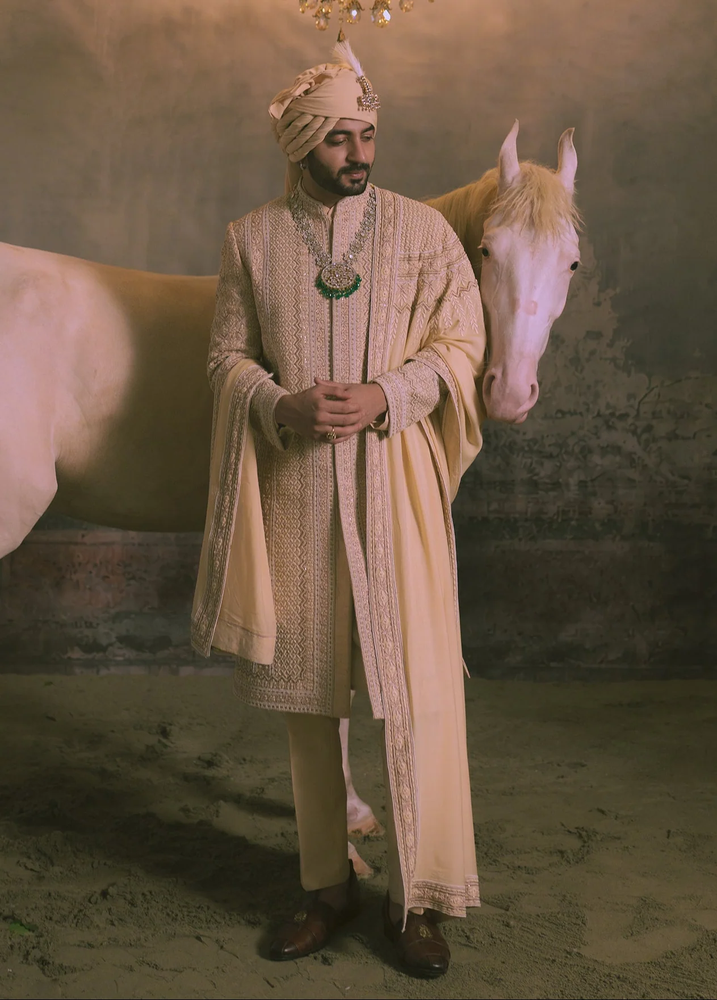

For a long time, Indian craft lived in a slightly awkward category. It was admired, certainly, and often sincerely. But it was admired the way a heritage monument is admired: from a respectful distance, with a plaque, as something that belonged to the past and needed protecting from the present.

That posture is changing. Across fashion, jewellery, accessories and the home, a generation of designers has stopped asking how to preserve craft and started asking what it can do. The question has moved from conservation to conversation. And the answers are producing some of the most confident, most distinctive design coming out of India in decades.

This is the craft renaissance. It is less a revival than a reorientation: the moment a tradition stops being treated as heritage and starts being used as a language.

#### **Brands Championing The Craft**

**Bonsoir** is a men's fashion brand with over 28 years of experience, founded in Delhi and now operating out of Noida. The brand brings together traditional Indian craftsmanship and contemporary tailoring across its range of formal and occasionwear, including kurtas, jackets, Bandhgalas, suits, blazers and sherwanis.

Rooted in heritage craftsmanship, Bonsoir works closely with skilled local artisans and craftsmen, with a focus on intricate motifs, hand embroidery and detailed craftsmanship. By bringing traditional techniques together with modern silhouettes and refined tailoring, the brand continues to explore new interpretations of Indian menswear for the modern man.

At **Neeman’s,** craftsmanship is an expression of thoughtful design, where every detail is informed by the way people move, live and experience comfort. Founded in 2018, the brand was born from a simple yet compelling question: *why couldn’t good-looking shoes be comfortable too?*

This curiosity evolved into a design philosophy shaped by material exploration, ergonomic precision and functional innovation. Drawing on the nuances of Indian foot anatomy, we approach footwear through an understanding of natural movement and the way feet interact with different surfaces. Every contour, cushioning element and structural detail is thoughtfully engineered to deliver flexibility, adaptability and lasting support. 

Our interpretation of craft is equally reflected in our choice of materials – bringing together the natural finesse of Merino wool and organic cotton with recycled PET-derived fibres and recycled rubber. We also draw from India's rich textile traditions. The [कला Kicks](https://neemans.com/products/klaa-kicks-for-men-tan?srsltid=AYCX9vI5RFlhKhKnkjDMTfiAsC0io_1Y5a8c0FomRBKgE8UQr5thU01c) collection reinterprets the distinctive running stitches of Kantha embroidery through contemporary footwear, while the knitted constructions across [Begin Walk](https://neemans.com/collections/begin-walk-collection), [Knit Gliders](https://neemans.com/search?q=Knit+Gliders+collection) and [90s Retro](https://neemans.com/products/the-90s-duo-sneakers-for-men-black-ivory?_pos=1&_sid=c3447361a&_ss=r) collections translate textile-inspired techniques through modern technology and material science.

At Neeman’s, artistry resides as much in the visible as in the experiential. Through considered silhouettes, intelligent construction and an interplay of form and function, we bring traditional influences into a contemporary design context, where every detail serves a purpose and comfort becomes a design language in itself.

Indian craftsmanship has long been defined by its richness, intricate detailing and regional textile traditions. With her latest collection, **‘Bombay से Beyond – Postcard to Reality**’, designer Maheka Mirpuri has brought these elements into a contemporary couture context, drawing inspiration from the glamour, elegance and old-world sophistication of Bombay.

Rooted in the designer's nostalgia for a bygone era, the collection explores how traditional Indian textiles and artisanal detailing can be reinterpreted through modern silhouettes. At its heart Maheka's ‘Bombay Begum’ is a woman who embodies grace, confidence and understated royalty. Her wardrobe brings together sculpted silhouettes, cinched waists and corsets with pearls, vintage-inspired jewellery and intricate embellishment.

Speaking about the collection, Maheka Mirpuri shares, 

> “Bombay से Beyond is my way of bringing back the Bombay I have always loved,  the glamour, the elegance and the beautiful way women dress. I wanted to create a collection that feels like a memory, but can still be worn and loved today.”
