There is a short window each year when India is simply at its best. The monsoon has long since lifted, the humidity has gone, and the light turns clear and golden. A palace courtyard is warm at noon and cool by evening, and a beach is a pleasure rather than an endurance test. Winter is the season the country has been waiting for.

The good rooms know it too. By the second week of December, the properties worth travelling for are filling, and the long weekend between Christmas and the New Year has already become the hardest stretch of the calendar to book. The people who travel well in winter are the ones who decided early.

This is the edit: where to go, what each place offers, and why now is the right moment to choose.

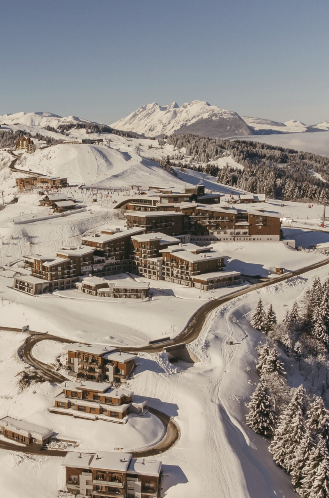

For a growing number of Indian families, the most compelling winter holiday now ends in snow. **Club Med** reports a 282% increase in business volume from India for Winter 2027 compared with Winter 2026, driven in part by the appeal of multigenerational travel: a European ski resort offers skiing and snowboarding for enthusiasts, group lessons for beginners, and snowshoeing, sledging, spa and culinary experiences for those who prefer the mountains without the slopes, with children's clubs in many resorts. Club Med's all-inclusive model brings together lessons, lift passes, equipment, accommodation and dining, which simplifies a first ski trip considerably. 

> *"The Alps offer a compelling combination of adventure, discovery and time together"* 

says **Bruno Courbet, Country Director for Thailand, India, Indonesia and New Markets at Club Med**. Its portfolio spans 15 mountain resorts across Europe, among them Val d'Isère, its first Exclusive Collection resort in the Alps and the most popular with Indian clients, Tignes, with slopes reaching up to 3,600 metres, Grand Massif Samoëns Morillon, around an hour and a half from Geneva Airport, and Pragelato Sestriere in Italy's Via Lattea ski area, reachable via direct flights from New Delhi to Milan followed by a transfer. Stays run up to seven nights, with three- and four-night options at selected resorts for shorter breaks.

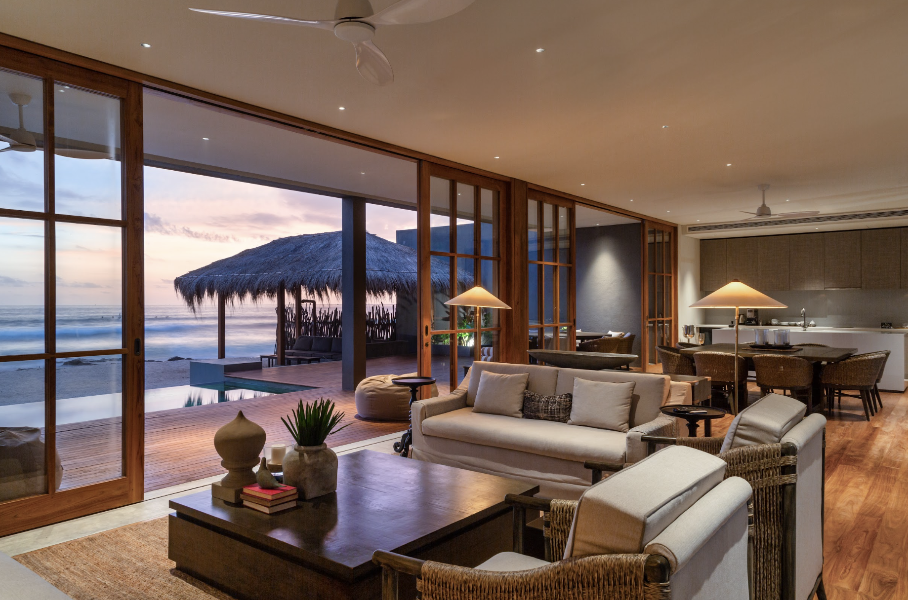

#### **The Six, Weligama, Sri Lanka**

Located along the shores of Weligama, The Six is an exclusive collection of six luxury beachfront villas, each featuring four ensuite bedrooms, a private swimming pool and direct beach access. Drawing inspiration from six coastal destinations across the world, Bali, Hawaii, Greece, Australia, Italy and Spain, each villa has its own distinct design identity. With expansive indoor-outdoor living spaces, contemporary interiors and personalised hospitality, The Six brings together privacy, thoughtful design and the natural beauty of Sri Lanka’s southern coastline

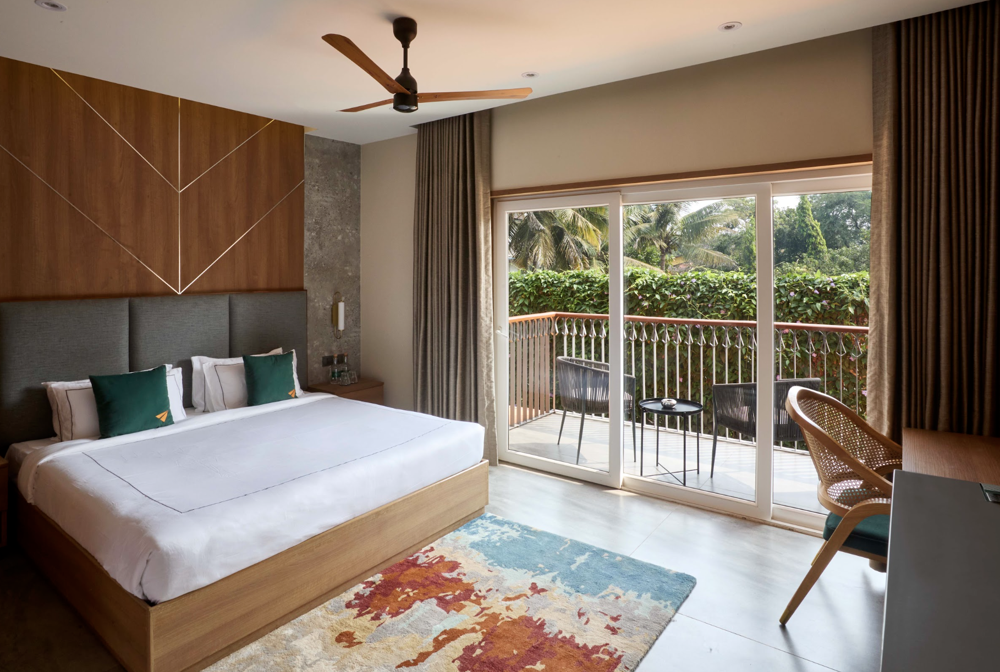

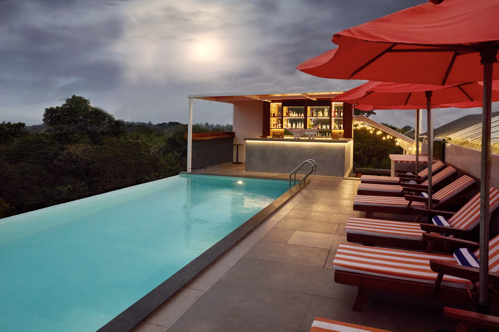

#### **The Passport Hotel, Goa**

What if your next Goan getaway was planned around cocktails rather than just beaches? **The Passport Hotel, Assagao**, brings a fresh perspective to boutique hospitality as India’s first cocktail-forward travellers’ hotel, where the drinking experience is at the heart of the stay. This 27-key property invites guests to discover Goa through its cocktail culture, from the lobby’s **MINI BAR**, a social hub for travellers and locals, to **Layover**, the rooftop infinity pool and swim-up bar designed for leisurely afternoons and sundowner sessions. For those who prefer to play mixologist themselves, in-room DIY cocktail setups bring the bar experience into the privacy of their rooms. The experience extends beyond the hotel through its **Passport Stamping Programme**, encouraging guests to explore partner bars across Goa and collect stamps along the way. More than just a place to stay, The Passport Hotel turns cocktail discovery into an integral part of the Goan holiday.

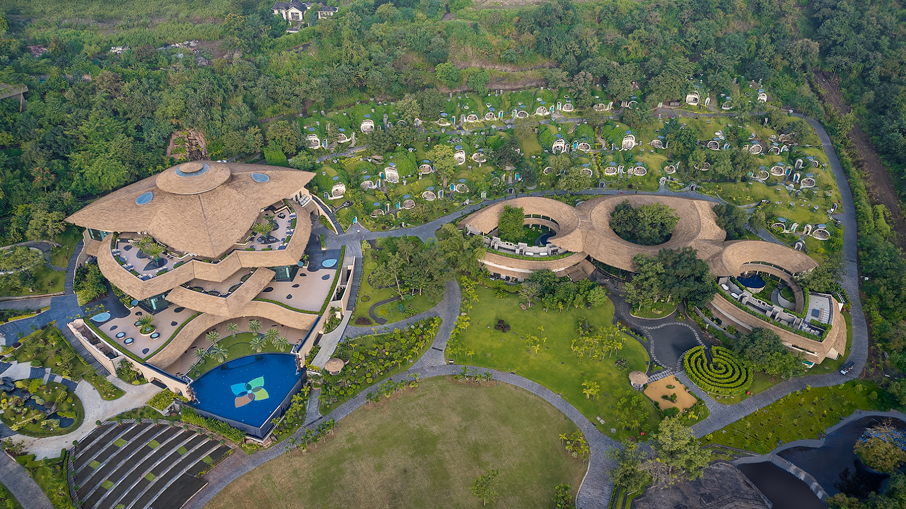

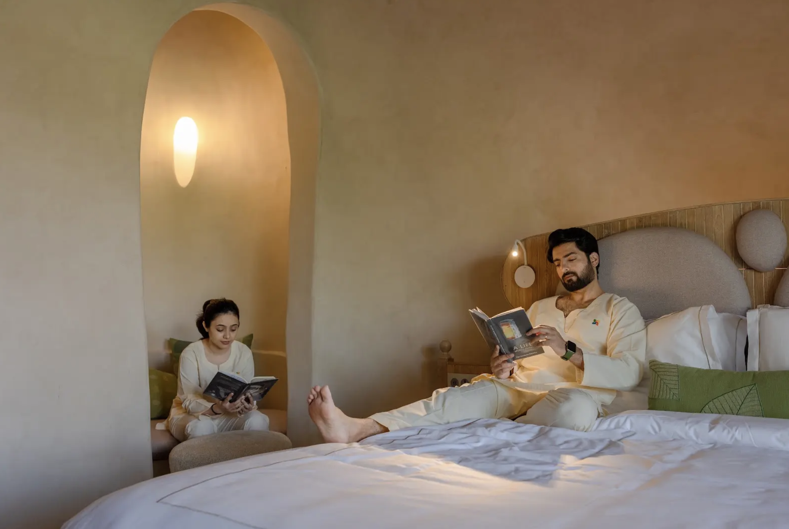

#### **Swastik Wellbeing, Pune**

Travel is shifting from indulgent escapes to more intentional, purpose-led experiences, and retreats like Swastik Wellbeing, Pune reflect this change. Spread across 51 acres by the Khadakwasla waters, Swastik blends ancient wisdom with modern wellbeing practices. 

The retreat now offers focused Healing and Wellness programmes addressing lifestyle concerns such as weight management, gut health, diabetes care, sleep optimisation, cardiac wellness, women’s health, fertility, stress management, digital detox, longevity, Panchakarma, and babymoon wellbeing. Complementing these is a newly introduced Wellness Holiday—a flexible stay designed for guests seeking rest, simplicity, nourished food, better sleep, and time in nature, without fixed schedules or structured therapies.

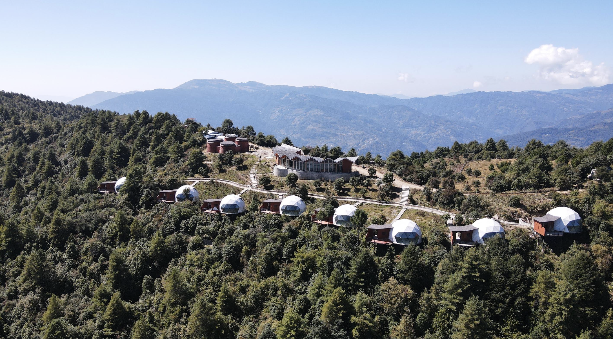

#### **Kunda Himalayan Resort & Spa, Solukhumbu, Nepal**

Most travellers only pass through Nepal’s Everest region on the way to base camp. Winter is the time to stay. The setting is Phaplu, a village in the Solukhumbu foothills with views of the Himalayan range. Walk the mountain paths, go horseback riding, visit the monastery and sit in on a chanting session, or do nothing at all.

Kunda Himalayan Resort & Spa invites you to stay at around 3,100 metres. Eight geodesic dome villas stand against the mountains, with no crowds and no neighbour beyond the next ridgeline. Each has a private balcony with a hot tub and a fireplace, while a private butler looks after everything discreetly.

Ayurveda sets the pace. A resident doctor reads each guest’s constitution, and treatments and meals are tailored to it, rebalancing rather than rushing in the thin air. Kunda’s season runs from October to early January, when the mountain days are crisp and the nights are clear enough to see the Milky Way from the stargazing deck, with no light pollution to dim it.

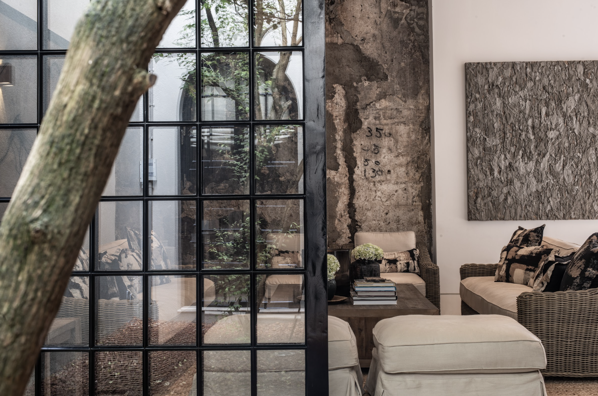

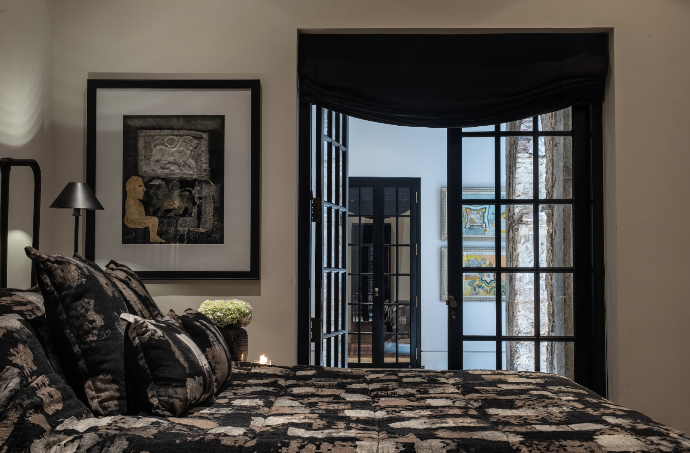

#### **77 Leyn Baan, Sri lanka**

Tucked away within the historic Galle Fort, 77 Leyn Baan is an intimate boutique townhouse that reflects the architectural charm and cultural character of its surroundings. **Chaired by legendary Sri Lankan cricketer Kumar Sangakkara**, the property is located within the UNESCO World Heritage Site, the property offers easy access to the fort’s cobblestone streets, colonial-era architecture, independent boutiques, art galleries and cafés. With its distinctive setting and personalised hospitality, it offers a charming base from which to discover Galle’s history, culture and coastal atmosphere.

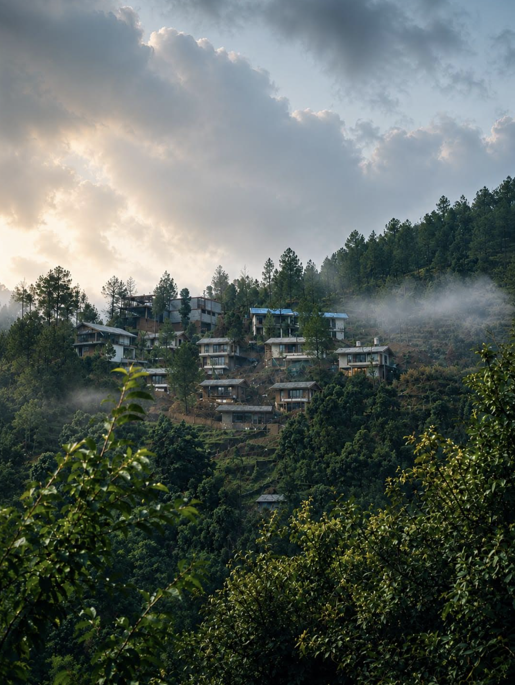

#### **Arth by Mayfair, Almora, Uttarakhand**

Kumaon has its own word for the early hour before the day begins: *byānai*. Winter is the season to meet it. Set out on foot through oak and rhododendron forest, pausing to hear the dawn chorus before you see a single bird. Reach an open ridge as the high peaks catch the light. Later comes *bān bhitar*, meaning “inside the forest”: phones away, 20 minutes of silence at a spot of your own. Birdwatching, botanical walks, village immersions and cultural storytelling round out the days.

This and more are tailor-made at **Arth by Mayfair**, a modern luxury wellness retreat in the Kumaon mountains, about 21 km from Almora. Designed around the philosophy of *Arrival of Quiet, Awakening of the Senses, Return to Essence*, it has 13 villas, including botanically inspired chalets named after native Himalayan plants.

The menu champions indigenous grains and local sourcing. This is where wellness meets wildlife and nature.

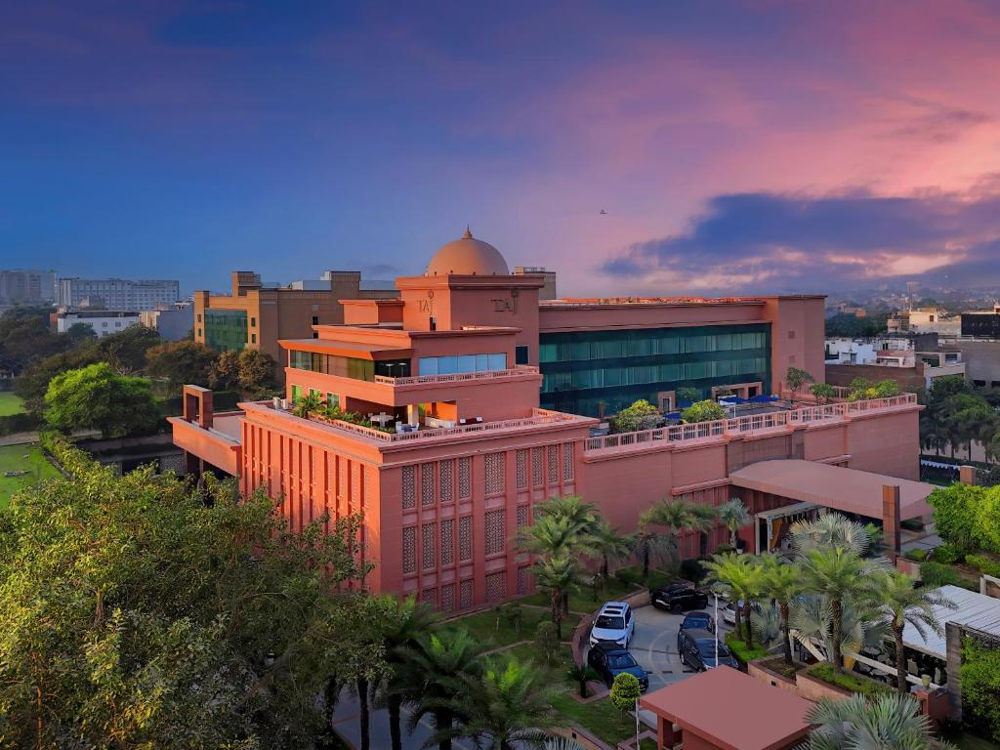

#### **Taj Agra**

Winter is Agra's most enchanting season, with pleasant weather ideal for exploring the iconic Taj Mahal, located just a ten-minute walk from its Eastern Gate. Taj Agra offers a perfect blend of heritage, luxury, and memorable culinary experiences. The highlight of the season is Infini, the city's premier sky lounge, where guests can enjoy romantic dining experiences alongside newly introduced sizzlers, warm winter cocktails, and cognac-based digestives. Seasonal breakfast, lunch, and dinner buffets at Palato celebrate winter produce and festive flavours, while Daawat-e-Nawab showcases authentic royal Indian cuisine. Guests can also unwind at the J Wellness Circle Spa after a day of sightseeing. With festive décor, Christmas celebrations, and New Year experiences, Taj Agra is the perfect winter escape for couples, families, and leisure travellers.

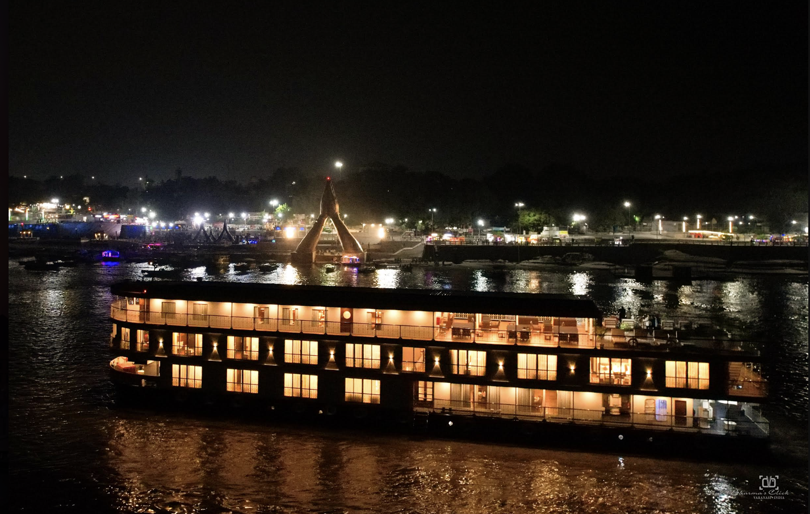

#### **Gangotri – A Divine River Retreat, Varanasi, Uttar Pradesh**

Varanasi is best seen from the river, and winter is when it is most comfortable to be out on it. This year, Dev Deepawali falls on 24 November, the full moon of Kartik, when the ghats are lit with lakhs of diyas for the gods themselves. The best seat is on the water.

**Gangotri – A Divine River Retreat** is moored on the Ganga at Sant Ravidas Ghat, Lanka, placing you right in the middle of the experience. Its 24 air-conditioned rooms, comprising 22 Deluxe rooms and two luxury suites, offer views of the ghats.

Mornings begin with sunrise yoga on the sun deck, followed by a cruise past all 84 ghats in natural light. In the evening, the ghats are illuminated, and you can watch the Ganga Aarti from the water. A speedboat takes you directly to the ghats nearest the city's main sights, including the Kashi Vishwanath Temple, allowing you to skip the traffic.

Back on board, guests can enjoy a pure-vegetarian restaurant, a spa, evening classical music and a riverside café lounge. Sant Ravidas Ghat is also accessible to wheelchair users and senior citizens.

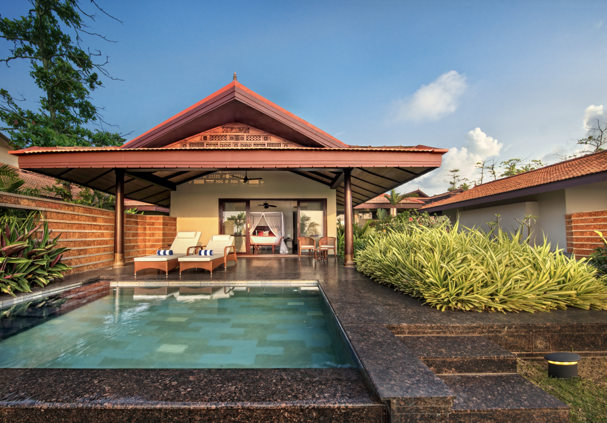

#### **Niraamaya Backwaters & Beyond in Kumarakom, Kerala**

Surrounded by Kerala's tranquil backwaters, lush greenery and rich natural landscapes, Niraamaya Backwaters & Beyond in Kumarakom, Kerala, offers an inviting setting for a winter escape. The season is particularly rewarding for exploring the region, enjoying its birdlife, experiencing village life and discovering the unique charm of Kerala's backwater culture.The retreat features thoughtfully designed private villas that offer a sense of space, privacy and connection with nature. Guests can complement their stay with personalised Ayurveda therapies, yoga, meditation and holistic wellness experiences designed to support relaxation and rejuvenation.Beyond its wellness offerings, the destination invites guests to slow down and experience the quieter side of Kerala, from peaceful mornings by the lake to leisurely moments surrounded by nature. Its proximity to the region's cultural experiences and backwater attractions further enriches the stay.Combining the beauty of Vembanad Lake, Kerala's cultural heritage and traditional wellness practices, Niraamaya Backwaters & Beyond presents a distinctive winter escape for travellers seeking a meaningful break, a slower pace of living and a renewed sense of wellbeing.

#### **Varun Chadha, CEO of Tirun says,**

*“Winter is an exciting time for Indian travellers to explore the world, particularly destinations that offer a change of scenery, warmer weather and memorable experiences. At TIRUN Travel Marketing, we see cruising as a compelling way to experience these escapes, bringing together the destination, the journey and the experiences onboard.*

*For those looking for a convenient international holiday, Southeast Asia is an excellent choice. Royal Caribbean’sNavigator of the Seas, with its year-round sailings from Singapore, opens up exciting possibilities for Indian travellers. Its itineraries covering destinations such as Penang and Penang, Phuket & Langkawi  make it easier to explore the region by sea, particularly for those looking to combine a flight to Singapore with a short cruise holiday.*

*Travellers seeking tropical escapes can look towards the Caribbean, while Alaska, Australia and New Zealand offer spectacular landscapes and distinctive cruising experiences. For those drawn to more immersive journeys, the Arctic and Antarctica present extraordinary opportunities to explore remote ecosystems and encounter wildlife up close.*

*Through TIRUN Travel Marketing, Indian travellers can explore and book a cruise with the brand that best matches the destination they wish to discover and the kind of holiday they have in mind. Whether it is a sun-soaked Caribbean escape with Royal Caribbean International, a contemporary luxury experience with Celebrity Cruises or an ultra-luxury voyage with Silversea, travellers can find an experience suited to their preferences. Each cruise line offers a different way to explore the world, opening up a wide range of destinations and experiences.*

*Ultimately, cruising allows travellers to discover more in one holiday. It is not just about where you go, but everything you experience along the way. This winter, that could mean exploring Southeast Asia over a few days or embarking on a once-in-a-lifetime journey across some of the world's most remarkable destinations.”*

#### **The Point of Going**

Winter is the season in which India repays the traveller who has been patient. The weather is on your side. The landscapes are at their most photogenic. And the very best places have the margin of calm, between the monsoon and the summer crowds, that makes them feel like discoveries rather than destinations.

The only decision left is when to go, and the answer, as every considered traveller learns, is a little earlier than you think.

***Follow Best List India for the culture, conversations, and ideas worth paying attention to.***
